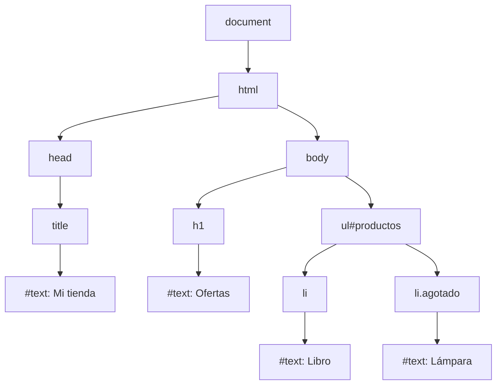
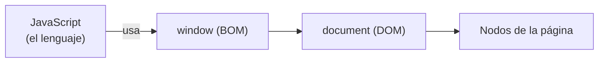

# 1. Qué es el DOM

[⬅️ Volver a la unidad](./README.md)

## Índice

- [1.1. Del HTML al árbol de objetos](#11-del-html-al-árbol-de-objetos)
- [1.2. El árbol de nodos](#12-el-árbol-de-nodos)
  - [1.2.1. Relaciones entre nodos](#121-relaciones-entre-nodos)
  - [1.2.2. Los nodos de texto](#122-los-nodos-de-texto)
- [1.3. El HTML no es el DOM](#13-el-html-no-es-el-dom)
- [1.4. DOM, BOM y JavaScript](#14-dom-bom-y-javascript)
- [1.5. Un estándar vivo: el WHATWG](#15-un-estándar-vivo-el-whatwg)
- [1.6. Ver el DOM en las DevTools](#16-ver-el-dom-en-las-devtools)
- [1.7. Ejemplo integrador: el árbol de una página](#17-ejemplo-integrador-el-árbol-de-una-página)
- [Resumen](#resumen)
- [Ejercicios de reflexión](#ejercicios-de-reflexión)

> **CE que trabaja este tema:** RA6 a.

---

## 1.1. Del HTML al árbol de objetos

Cuando el navegador recibe una página, el HTML es solo **texto**. Para mostrarla y para que JavaScript pueda trabajar con ella, el navegador la **analiza** (*parsing*) y construye en memoria una estructura de **objetos**, uno por cada etiqueta, cada texto y cada comentario. Esa estructura es el **DOM** (*Document Object Model*, modelo de objetos del documento).

```html
<!doctype html>
<html lang="es">
  <head>
    <title>Mi tienda</title>
  </head>
  <body>
    <h1>Ofertas</h1>
    <ul id="productos">
      <li>Libro</li>
      <li class="agotado">Lámpara</li>
    </ul>
  </body>
</html>
```

```js
const lista = document.querySelector('#productos'); // un objeto del DOM
console.log(lista.children.length);                 // 2
lista.children[0].textContent = 'Libro (¡oferta!)'; // la página cambia al momento
```

El DOM es el **puente** entre la página y el código: JavaScript no modifica el HTML (el texto que llegó del servidor), modifica los **objetos**, y el navegador vuelve a pintar la página con los cambios.

> 📝 **Nota del Profesor**: En la UD4 ya usaste `document.querySelector`, `textContent` e `innerHTML` para generar contenido. En esta unidad entiendes qué hay debajo: el modelo de objetos completo, cómo recorrerlo, modificarlo y hacerlo de forma que funcione en todos los navegadores.

---

## 1.2. El árbol de nodos

El DOM se organiza como un **árbol**: cada objeto es un **nodo**, y los nodos se anidan igual que las etiquetas.



El diagrama muestra el árbol del HTML anterior. La raíz es el objeto `document`; su único hijo elemento es `<html>`, y de ahí cuelga todo lo demás. Los textos (`#text`) son nodos hoja.

### 1.2.1. Relaciones entre nodos

Como en un árbol genealógico:

| Relación | En el ejemplo |
|----------|---------------|
| **Padre** (*parent*) | El padre de `ul` es `body` |
| **Hijos** (*children*) | Los hijos elemento de `ul` son los dos `li` |
| **Hermanos** (*siblings*) | `h1` y `ul` son hermanos |
| **Ascendientes** | `li` tiene como ascendientes `ul`, `body`, `html` y `document` |
| **Descendientes** | Todos los nodos son descendientes de `document` |

Estas relaciones son las que se usan para **recorrer** el documento desde el código (tema 3).

### 1.2.2. Los nodos de texto

No solo las etiquetas son nodos: también los **textos** que contienen, los **comentarios** y hasta los **espacios y saltos de línea** entre etiquetas.

```html
<ul>
  <li>Libro</li>
</ul>
```

El `ul` de arriba tiene **tres** nodos hijos: un texto con el salto de línea y los espacios, el `li` y otro texto con el salto final. Por eso existen dos familias de propiedades para recorrer: las que incluyen todos los nodos (`childNodes`) y las que solo incluyen **elementos** (`children`). Lo verás en el tema 3.

> 💡 **Tip del Examinador**: "¿Cuántos nodos hijos tiene `<p>Hola <b>mundo</b></p>`?" → Dos: el nodo de texto «Hola » y el elemento `<b>` (que, a su vez, tiene un nodo de texto hijo «mundo»).

---

## 1.3. El HTML no es el DOM

El DOM **parte** del HTML, pero no es lo mismo:

| Diferencia | Ejemplo |
|------------|---------|
| El navegador **corrige** el HTML incorrecto al construir el DOM | Un `<p>` sin cerrar se cierra; una tabla sin `<tbody>` recibe uno |
| El DOM **cambia** con JavaScript; el HTML recibido no | Añadir un `<li>` con código: el DOM lo tiene, el «código fuente» de la página no |
| El DOM tiene nodos que no se ven en el HTML | Los espacios en blanco como nodos de texto |

```html
<table>
  <tr><td>1</td></tr>
</table>
```

En el DOM, esa tabla tiene un `<tbody>` entre `<table>` y `<tr>`, aunque no esté en el HTML: lo añade el navegador porque lo exige el estándar.

> ⚠️ **Cuidado**: «Ver código fuente» (`Ctrl+U`) muestra el **HTML** que llegó del servidor. El panel **Elementos** de las DevTools muestra el **DOM** actual, con todo lo que ha cambiado JavaScript. Si buscas un elemento creado por tu código, búscalo en Elementos.

---

## 1.4. DOM, BOM y JavaScript

| | Qué es | Quién lo define |
|---|---|---|
| **JavaScript (ECMAScript)** | El lenguaje | Ecma (TC39) |
| **BOM** | Los objetos del navegador: `window`, `location`, `history`… (UD4) | Estándar HTML del WHATWG |
| **DOM** | Los objetos del documento: `document` y sus nodos | Estándar DOM del WHATWG (y HTML para los elementos) |

`document` es una propiedad de `window`: el DOM está **dentro** del BOM.



El diagrama sitúa cada pieza: el lenguaje no sabe nada de páginas; el navegador le da `window`, y desde ahí `document` y su árbol.

> 📝 **Nota del Profesor**: Por eso el DOM **no existe en Node.js**: Node.js tiene JavaScript, pero no un navegador ni una página. Para probar código del DOM con Vitest en Node.js se usa una implementación del DOM escrita en JavaScript, como **happy-dom** o **jsdom** (tema 8).

---

## 1.5. Un estándar vivo: el WHATWG

El DOM lo define el **WHATWG** (*Web Hypertext Application Technology Working Group*), el grupo formado por los fabricantes de navegadores (Apple, Google, Mozilla, Microsoft). Publica **estándares vivos** (*living standards*): no hay versiones numeradas, sino un documento que se actualiza continuamente.

- **DOM Standard**: nodos, árbol, eventos (<https://dom.spec.whatwg.org>).
- **HTML Standard**: los elementos concretos (`HTMLInputElement`, `<dialog>`…) y el BOM (<https://html.spec.whatwg.org>).

Antes los mantenía el **W3C** con versiones (DOM nivel 1, 2, 3). Si ves esos nombres en material antiguo, ya sabes de dónde vienen.

> 💡 **Tip del Examinador**: "¿Quién define el estándar del DOM?" → El WHATWG, como un estándar vivo (DOM Standard y HTML Standard). Antes lo hacía el W3C en niveles (DOM Level 1, 2 y 3).

---

## 1.6. Ver el DOM en las DevTools

El panel **Elementos** (*Elements*) de las DevTools muestra el árbol DOM **en directo**:

- Despliega y pliega los nodos para ver el árbol.
- Al seleccionar un nodo, en la consola puedes usarlo como **`$0`**: `$0.textContent`, `$0.children`…
- Haz doble clic en un texto o un atributo para editarlo: cambias el DOM, no el fichero.
- El panel lateral muestra los estilos, las propiedades del objeto y sus eventos.

```js
// En la consola, con un <li> seleccionado en Elementos
$0;              // el elemento seleccionado
$0.parentNode;   // su padre
$0.nodeName;     // 'LI'
```

---

## 1.7. Ejemplo integrador: el árbol de una página

Una función que recorre el DOM de forma **recursiva** (UD3) y muestra su estructura en la consola, con sangría según la profundidad:

```js
// arbol.js
/**
 * Muestra el árbol DOM a partir de un nodo, con sangría según la profundidad.
 * @param {Node} nodo
 * @param {number} [nivel=0]
 */
function mostrarArbol(nodo, nivel = 0) {
  const sangria = '  '.repeat(nivel);
  if (nodo.nodeType === Node.TEXT_NODE) {
    const texto = nodo.textContent.trim();
    if (texto !== '') console.log(`${sangria}"${texto}"`); // se omiten los textos que solo tienen espacios
    return;
  }
  const id = nodo.id ? `#${nodo.id}` : '';
  const clases = nodo.classList?.length ? `.${[...nodo.classList].join('.')}` : '';
  console.log(`${sangria}${nodo.nodeName.toLowerCase()}${id}${clases}`);
  for (const hijo of nodo.childNodes) mostrarArbol(hijo, nivel + 1);
}

mostrarArbol(document.body);
```

```text
// Salida con el HTML del apartado 1.1:
body
  h1
    "Ofertas"
  ul#productos
    li
      "Libro"
    li.agotado
      "Lámpara"
```

- Se recorre con **recursividad**, porque el árbol no tiene una profundidad fija.
- Cada nodo sabe de qué tipo es (`nodeType`) y cómo se llama (`nodeName`).
- Los nodos de texto con solo espacios están en `childNodes`: hay que saltarlos para que la salida sea legible.

---

## Resumen

- El **DOM** es la representación de la página como un **árbol de objetos** que construye el navegador a partir del HTML.
- Cada etiqueta, texto y comentario es un **nodo**; la raíz es `document`.
- Los nodos se relacionan como **padres**, **hijos** y **hermanos**; los espacios entre etiquetas también son nodos de texto.
- El DOM **no es** el HTML: el navegador lo corrige al construirlo y JavaScript lo cambia después.
- `document` cuelga de `window`: el DOM está dentro del BOM. En Node.js no hay DOM.
- El estándar lo define el **WHATWG** como un estándar vivo.
- El panel **Elementos** de las DevTools muestra el DOM actual; `$0` es el nodo seleccionado.

## Ejercicios de reflexión

1. Dibuja el árbol DOM de `<p>Precio: <strong>20 €</strong> con IVA</p>`. ¿Cuántos nodos tiene?
2. Escribe en un HTML una tabla sin `<tbody>` y compruébalo en el panel Elementos. ¿Qué ves?
3. ¿Por qué «Ver código fuente» no muestra un elemento que ha añadido tu JavaScript?
4. ¿Por qué no se puede usar `document` en un programa de Node.js? ¿Qué se usa para probar código del DOM con Vitest?
5. Busca en la web del WHATWG el DOM Standard. ¿Qué significa que sea un «estándar vivo»?

---

[⬅️ Volver a la unidad](./README.md)
