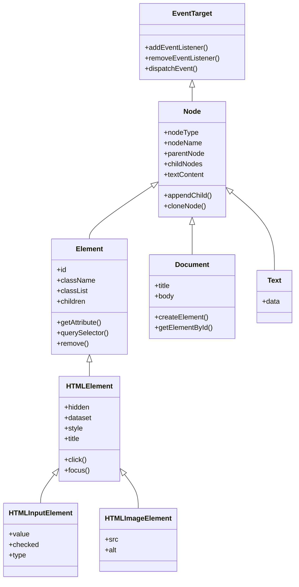

# 2. Los objetos del modelo

[⬅️ Volver a la unidad](./README.md)

## Índice

- [2.1. Una jerarquía de interfaces](#21-una-jerarquía-de-interfaces)
- [2.2. `Node`: lo común a todos los nodos](#22-node-lo-común-a-todos-los-nodos)
  - [2.2.1. Tipos de nodo](#221-tipos-de-nodo)
- [2.3. `Element` y `HTMLElement`](#23-element-y-htmlelement)
  - [2.3.1. Interfaces de cada etiqueta](#231-interfaces-de-cada-etiqueta)
  - [2.3.2. Atributos y propiedades](#232-atributos-y-propiedades)
- [2.4. `Document`](#24-document)
- [2.5. `Text` y los demás nodos](#25-text-y-los-demás-nodos)
- [2.6. Colecciones de nodos](#26-colecciones-de-nodos)
  - [2.6.1. `NodeList` estática y viva](#261-nodelist-estática-y-viva)
  - [2.6.2. `HTMLCollection`](#262-htmlcollection)
- [2.7. `DocumentFragment`](#27-documentfragment)
- [2.8. Ejemplo integrador: inspector de un elemento](#28-ejemplo-integrador-inspector-de-un-elemento)
- [Resumen](#resumen)
- [Ejercicios de reflexión](#ejercicios-de-reflexión)

> **CE que trabaja este tema:** RA6 b.

---

## 2.1. Una jerarquía de interfaces

Los objetos del DOM no son todos iguales: un `<input>` tiene `value` y un `` tiene `src`, pero los dos tienen `id` y `textContent`. El estándar los organiza en una **jerarquía de interfaces** (como las clases y la herencia de la UD3): cada tipo hereda las propiedades y métodos del anterior y añade los suyos.



El diagrama muestra la cadena de herencia: un `<input>` es un `HTMLInputElement`, que es un `HTMLElement`, que es un `Element`, que es un `Node`, que es un `EventTarget`. Por eso puedes llamar a `addEventListener` sobre cualquier nodo, y a `querySelector` sobre cualquier elemento.

```js
const campo = document.querySelector('input');
console.log(campo instanceof HTMLInputElement); // true
console.log(campo instanceof Element);          // true
console.log(campo instanceof EventTarget);      // true
```

> 📝 **Nota del Profesor**: Es la **cadena de prototipos** de la UD3 aplicada al navegador. Si buscas en MDN `HTMLInputElement`, verás sus propiedades propias y, debajo, las heredadas de cada interfaz superior.

> 💡 **Tip del Examinador**: "¿De qué interfaz heredan todos los nodos del DOM, y para qué?" → De `Node`, que a su vez hereda de `EventTarget`. Por eso todos los nodos tienen propiedades como `parentNode` o `textContent` y pueden recibir eventos con `addEventListener`.

---

## 2.2. `Node`: lo común a todos los nodos

| Propiedad o método | Qué es |
|--------------------|--------|
| `nodeType` | Número del tipo de nodo (apartado 2.2.1) |
| `nodeName` | Nombre: `'LI'` para un elemento, `'#text'` para un texto, `'#document'` |
| `parentNode` | El nodo padre |
| `childNodes` | Todos los hijos (incluidos los de texto) |
| `firstChild`, `lastChild`, `nextSibling`, `previousSibling` | Hijos y hermanos (de cualquier tipo) |
| `textContent` | El texto del nodo y de todos sus descendientes |
| `appendChild(n)`, `insertBefore(n, ref)`, `removeChild(n)`, `replaceChild(n, viejo)` | Modificar el árbol (forma clásica; tema 4) |
| `cloneNode(profundo)` | Copia del nodo (con sus descendientes si `profundo` es `true`) |
| `contains(n)` | Si `n` es el propio nodo o uno de sus descendientes |

### 2.2.1. Tipos de nodo

| Constante | Valor | Ejemplo | `nodeName` |
|-----------|:-----:|---------|------------|
| `Node.ELEMENT_NODE` | 1 | `<li>` | `'LI'` |
| `Node.TEXT_NODE` | 3 | Un texto | `'#text'` |
| `Node.COMMENT_NODE` | 8 | `<!-- … -->` | `'#comment'` |
| `Node.DOCUMENT_NODE` | 9 | `document` | `'#document'` |
| `Node.DOCUMENT_FRAGMENT_NODE` | 11 | Un `DocumentFragment` | `'#document-fragment'` |

```js
const parrafo = document.querySelector('p'); // <p>Hola <b>mundo</b></p>
for (const hijo of parrafo.childNodes) {
  console.log(hijo.nodeType, hijo.nodeName);
}
// 3 '#text'
// 1 'B'
```

> ✅ **Buena práctica**: Compara con las constantes (`nodo.nodeType === Node.TEXT_NODE`) en lugar de con los números: el código se entiende sin consultar la tabla.

---

## 2.3. `Element` y `HTMLElement`

`Element` añade lo propio de las etiquetas: identificador, clases, atributos, hijos **elemento** y búsquedas. `HTMLElement` añade lo propio de los elementos HTML: estilos, `dataset`, visibilidad, foco…

| Interfaz | Propiedades y métodos destacados |
|----------|----------------------------------|
| `Element` | `id`, `className`, `classList`, `tagName`, `children`, `firstElementChild`, `nextElementSibling`, `innerHTML`, `getAttribute`, `setAttribute`, `hasAttribute`, `removeAttribute`, `querySelector`, `querySelectorAll`, `closest`, `matches`, `append`, `prepend`, `before`, `after`, `replaceWith`, `remove` |
| `HTMLElement` | `hidden`, `title`, `lang`, `dataset`, `style`, `tabIndex`, `innerText`, `click()`, `focus()`, `blur()` |

### 2.3.1. Interfaces de cada etiqueta

Cada etiqueta tiene su interfaz con sus propiedades concretas:

| Etiqueta | Interfaz | Propiedades propias |
|----------|----------|---------------------|
| `<input>` | `HTMLInputElement` | `value`, `checked`, `type`, `disabled`, `valueAsNumber` |
| `<a>` | `HTMLAnchorElement` | `href`, `target`, `download` |
| `` | `HTMLImageElement` | `src`, `alt`, `naturalWidth`, `complete` |
| `<select>` | `HTMLSelectElement` | `value`, `options`, `selectedIndex` |
| `<form>` | `HTMLFormElement` | `elements`, `submit()`, `reset()` |
| `<dialog>` | `HTMLDialogElement` | `open`, `returnValue`, `showModal()`, `close()` |
| `<template>` | `HTMLTemplateElement` | `content` |

### 2.3.2. Atributos y propiedades

Un **atributo** está escrito en el HTML (`<input value="3">`); una **propiedad** es un dato del objeto del DOM (`campo.value`). Casi todos los atributos tienen una propiedad con el mismo nombre, pero **no siempre valen lo mismo**:

```js
// <input id="cantidad" value="3">
const campo = document.querySelector('#cantidad');
campo.value = '7';                         // el usuario o el código cambian el valor
console.log(campo.value);                  // '7': el valor ACTUAL (propiedad)
console.log(campo.getAttribute('value'));  // '3': el valor INICIAL (atributo del HTML)

// href: la propiedad es la URL completa, el atributo lo escrito
// <a href="/ofertas">…</a>
const enlace = document.querySelector('a');
console.log(enlace.href);                  // 'https://tienda.example/ofertas'
console.log(enlace.getAttribute('href'));  // '/ofertas'
```

| Usa la propiedad | Usa `getAttribute`/`setAttribute` |
|------------------|-----------------------------------|
| Para leer el estado **actual** (`value`, `checked`) | Para atributos personalizados y para los de accesibilidad (`aria-*`, `role`) |
| Para la mayoría de atributos estándar (`id`, `src`, `href`, `disabled`) | Para leer el valor **escrito** en el HTML |

Los atributos de accesibilidad también tienen propiedad (`boton.role`, `boton.ariaExpanded`, Baseline desde 2023), pero en el curso se escriben con `setAttribute('aria-expanded', 'true')`: es la forma que funciona en todos los navegadores y la que verás en casi toda la documentación.

> ⚠️ **Cuidado**: Algunas propiedades no se llaman como el atributo porque el nombre está reservado en JavaScript: el atributo `class` es la propiedad `className` (y `classList`), y el atributo `for` de `<label>` es `htmlFor`.

---

## 2.4. `Document`

`document` es el nodo raíz y la **puerta de entrada** al DOM:

| Miembro | Qué es |
|---------|--------|
| `document.documentElement` | El elemento `<html>` |
| `document.head`, `document.body` | `<head>` y `<body>` |
| `document.title` | El título de la pestaña (UD4) |
| `document.readyState` | `'loading'`, `'interactive'` o `'complete'` (tema 5) |
| `getElementById`, `querySelector`, `querySelectorAll` | Buscar elementos (tema 3) |
| `createElement`, `createTextNode`, `createDocumentFragment` | Crear nodos (tema 4) |
| `activeElement` | El elemento que tiene el foco |

---

## 2.5. `Text` y los demás nodos

Un nodo `Text` tiene su contenido en `data` (o `textContent`). Rara vez se trabaja con ellos directamente: se cambia el `textContent` del elemento padre. Los **comentarios** (`Comment`) existen en el árbol y se pueden leer, pero no se muestran.

```js
const texto = document.createTextNode('Hola');
document.body.append(texto);
console.log(texto.data, texto.nodeType); // 'Hola' 3
```

---

## 2.6. Colecciones de nodos

Varias propiedades y métodos devuelven **colecciones**: listas de nodos parecidas a un array, pero que **no son arrays**.

### 2.6.1. `NodeList` estática y viva

`NodeList` es la colección que devuelven `querySelectorAll` y `childNodes`. Hay dos variantes:

- **Estática**: una foto del momento en que se pidió. Si el documento cambia después, no se entera. La devuelve `querySelectorAll`.
- **Viva** (*live*): se actualiza sola cuando cambia el documento. La devuelve `childNodes`.

```js
const items = document.querySelectorAll('li');     // NodeList estática
const hijos = document.querySelector('ul').childNodes; // NodeList viva

document.querySelector('ul').append(document.createElement('li'));
console.log(items.length);  // no cambia
console.log(hijos.length);  // ha aumentado en uno
```

`NodeList` tiene `length`, acceso por índice, `forEach` y es **iterable** (`for…of`, _spread_), pero **no** tiene `map`, `filter` ni `reduce`. Para usarlos, se convierte en array (UD3):

```js
const nombres = [...document.querySelectorAll('li')].map((li) => li.textContent);
const agotados = Array.from(document.querySelectorAll('li')).filter((li) => li.matches('.agotado'));
```

### 2.6.2. `HTMLCollection`

`HTMLCollection` es otra colección, **siempre viva** y solo de **elementos**. La devuelven `children`, `getElementsByTagName` y `getElementsByClassName`. No tiene `forEach`, pero es iterable con `for…of`.

| | `NodeList` de `querySelectorAll` | `NodeList` de `childNodes` | `HTMLCollection` |
|---|---|---|---|
| ¿Viva? | ❌ Estática | ✅ | ✅ |
| Contiene | Elementos | Todos los nodos | Solo elementos |
| `forEach` | ✅ | ✅ | ❌ |
| `for…of` y _spread_ | ✅ | ✅ | ✅ |
| `map`, `filter` | ❌ (convertir en array) | ❌ | ❌ |

> ⚠️ **Cuidado**: Recorrer una colección **viva** mientras se añaden o quitan elementos puede dar bucles infinitos o saltarse elementos. Si vas a modificar lo que recorres, conviértela antes en array (`[...coleccion]`): el array es una foto que no cambia.

> 💡 **Tip del Examinador**: "¿Qué diferencia hay entre una `NodeList` estática y una viva?" → La estática (`querySelectorAll`) es una copia del momento en que se pidió; la viva (`childNodes`, y las `HTMLCollection` como `children`) se actualiza sola cuando cambia el documento.

---

## 2.7. `DocumentFragment`

Un **`DocumentFragment`** es un "trozo de documento" que **no está en la página**: un contenedor ligero donde se preparan varios nodos antes de insertarlos todos de una vez. Al insertarlo, se insertan sus hijos y el fragmento queda vacío.

```js
const fragmento = document.createDocumentFragment();
for (const nombre of ['Pan', 'Leche', 'Café']) {
  const li = document.createElement('li');
  li.textContent = nombre;
  fragmento.append(li); // aún no está en la página: no se repinta nada
}
document.querySelector('ul').append(fragmento); // una sola inserción
```

Lo verás de nuevo en el tema 4, al hablar del rendimiento. El contenido de un `<template>` (`template.content`) también es un `DocumentFragment`.

---

## 2.8. Ejemplo integrador: inspector de un elemento

Una función que describe cualquier elemento usando las interfaces del tema:

```js
// inspector.js
/**
 * Describe un elemento: su interfaz, su cadena de herencia y sus datos principales.
 * @param {Element} elemento
 * @returns {string[]} Líneas de la descripción.
 */
function inspeccionar(elemento) {
  const cadena = [];
  let prototipo = Object.getPrototypeOf(elemento);
  while (prototipo && prototipo !== Object.prototype) {
    cadena.push(prototipo.constructor.name);
    prototipo = Object.getPrototypeOf(prototipo);
  }
  const atributos = [...elemento.attributes].map((a) => `${a.name}="${a.value}"`);
  return [
    `Etiqueta: ${elemento.tagName} · tipo de nodo: ${elemento.nodeType}`,
    `Herencia: ${cadena.join(' → ')}`,
    `Atributos: ${atributos.join(' ') || '(ninguno)'}`,
    `Hijos: ${elemento.childNodes.length} nodos, de ellos ${elemento.children.length} elementos`,
  ];
}

// <input id="cantidad" type="number" value="3">
inspeccionar(document.querySelector('#cantidad')).forEach((linea) => console.log(linea));
```

```text
// Salida en Chrome:
Etiqueta: INPUT · tipo de nodo: 1
Herencia: HTMLInputElement → HTMLElement → Element → Node → EventTarget
Atributos: id="cantidad" type="number" value="3"
Hijos: 0 nodos, de ellos 0 elementos
```

---

## Resumen

- Los objetos del DOM forman una **jerarquía de interfaces**: `EventTarget` → `Node` → `Element` → `HTMLElement` → `HTMLInputElement`…, más `Document` y `Text`.
- `Node` da el tipo (`nodeType`), el nombre, el padre, los hijos y `textContent`. Los tipos principales son elemento (1), texto (3), comentario (8) y documento (9).
- `Element` añade clases, atributos, hijos elemento y búsquedas; `HTMLElement`, `dataset`, `hidden`, `style` y el foco; cada etiqueta tiene su interfaz (`HTMLInputElement`…).
- Un **atributo** está en el HTML; una **propiedad**, en el objeto. `value` y `checked` reflejan el estado actual.
- `document` es la raíz y la puerta de entrada.
- `querySelectorAll` devuelve una `NodeList` **estática**; `childNodes`, una **viva**; `children`, una `HTMLCollection` **viva**. No son arrays.
- Un **`DocumentFragment`** prepara nodos fuera de la página para insertarlos de una vez.

## Ejercicios de reflexión

1. Busca en MDN la interfaz `HTMLSelectElement` y anota tres propiedades propias y tres heredadas.
2. Escribe el valor de `nodeType` y `nodeName` de `document`, de `document.body` y de un comentario.
3. Cambia el texto de un `<input>` a mano y compara en la consola `campo.value` y `campo.getAttribute('value')`. ¿Por qué son distintos?
4. ¿Qué pasa si recorres `document.getElementsByTagName('li')` con un `for` clásico y en cada vuelta añades un `<li>`?
5. ¿Por qué `document.querySelectorAll('li').map(…)` da error? ¿Cómo lo arreglas?

---

[⬅️ Volver a la unidad](./README.md)
