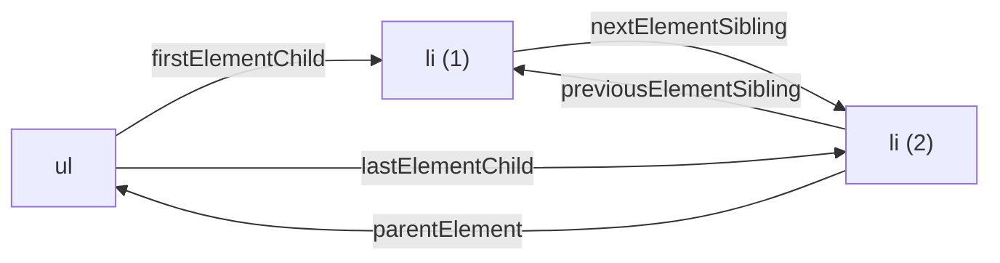

# 3. Acceder al documento

[⬅️ Volver a la unidad](./README.md)

## Índice

- [3.1. Cuándo está listo el documento](#31-cuándo-está-listo-el-documento)
- [3.2. Buscar elementos](#32-buscar-elementos)
  - [3.2.1. `getElementById`](#321-getelementbyid)
  - [3.2.2. `querySelector` y `querySelectorAll`](#322-queryselector-y-queryselectorall)
  - [3.2.3. Los métodos clásicos `getElementsBy…`](#323-los-métodos-clásicos-getelementsby)
  - [3.2.4. Buscar dentro de un elemento](#324-buscar-dentro-de-un-elemento)
- [3.3. `matches` y `closest`](#33-matches-y-closest)
- [3.4. Recorrer el árbol](#34-recorrer-el-árbol)
  - [3.4.1. Por elementos](#341-por-elementos)
  - [3.4.2. Por nodos](#342-por-nodos)
- [3.5. Leer contenido y atributos](#35-leer-contenido-y-atributos)
- [3.6. Verificar el acceso](#36-verificar-el-acceso)
- [3.7. Ejemplo integrador: índice automático](#37-ejemplo-integrador-índice-automático)
- [Resumen](#resumen)
- [Ejercicios de reflexión](#ejercicios-de-reflexión)

> **CE que trabaja este tema:** RA6 c.

---

## 3.1. Cuándo está listo el documento

Para buscar un elemento, tiene que **existir** en el DOM. Si el script se ejecuta antes de que el navegador haya leído esa parte del HTML, la búsqueda devuelve `null`.

```html
<head>
  <script>
    console.log(document.querySelector('h1')); // null: el <h1> aún no se ha leído
  </script>
</head>
<body>
  <h1>Hola</h1>
</body>
```

| Forma de cargar el script | ¿El DOM está listo al ejecutarse? |
|---------------------------|:---:|
| `<script>` normal en el `<head>` | ❌ |
| `<script>` al final del `<body>` | ✅ (lo anterior) |
| `<script defer>` | ✅ |
| `<script type="module">` | ✅ (es diferido) |

> ✅ **Buena práctica**: Carga el código con `<script type="module" src="…">` en el `<head>`, como en todo el curso: se descarga en paralelo y se ejecuta cuando el DOM está construido (UD1). En el tema 5 verás el evento `DOMContentLoaded` para los casos en que no se puede.

---

## 3.2. Buscar elementos

### 3.2.1. `getElementById`

Devuelve el elemento con ese `id`, o `null`. Es el más rápido, pero solo existe en `document`.

```js
const formulario = document.getElementById('pedido'); // sin '#'
```

### 3.2.2. `querySelector` y `querySelectorAll`

Reciben un **selector CSS**, el mismo que escribirías en una hoja de estilos:

- `querySelector(selector)`: el **primer** elemento que coincide, o `null`.
- `querySelectorAll(selector)`: **todos**, en una `NodeList` **estática** (vacía si no hay ninguno).

```js
document.querySelector('#pedido');                  // por id
document.querySelector('.destacado');               // primera con esa clase
document.querySelectorAll('ul#productos > li');     // hijos directos
document.querySelectorAll('li:not(.agotado)');      // pseudoclases
document.querySelector('input[name="email"]');      // por atributo
document.querySelectorAll('[data-categoria="libros"]'); // atributos data-*
document.querySelector('form button[type="submit"]');   // descendiente
```

| Selector | Selecciona |
|----------|-----------|
| `#id` | El elemento con ese `id` |
| `.clase` | Elementos con esa clase |
| `etiqueta` | Elementos de esa etiqueta |
| `a b` | `b` descendiente de `a` |
| `a > b` | `b` hijo directo de `a` |
| `[atributo]`, `[atributo="valor"]` | Por atributo |
| `:first-child`, `:last-child`, `:nth-child(2)` | Por posición |
| `:not(selector)`, `:checked`, `:disabled` | Pseudoclases |

> ⚠️ **Cuidado**: Si el selector no es válido (`'.123'`, `'#'`), se lanza una excepción: un `DOMException` cuyo nombre (`error.name`) es `'SyntaxError'`. Y si buscas un `id` que viene de datos, escápalo con `CSS.escape(id)`: `document.querySelector('#' + CSS.escape(id))`.

### 3.2.3. Los métodos clásicos `getElementsBy…`

| Método | Devuelve |
|--------|----------|
| `getElementsByTagName('li')` | `HTMLCollection` **viva** |
| `getElementsByClassName('agotado')` | `HTMLCollection` **viva** |
| `getElementsByName('email')` | `NodeList` viva |

Existen desde las primeras versiones del DOM y los verás en código heredado. Hoy se usa `querySelector(All)` por su flexibilidad.

> 💡 **Tip del Examinador**: "¿Qué diferencia hay entre `querySelectorAll('.x')` y `getElementsByClassName('x')`?" → El primero acepta cualquier selector CSS y devuelve una `NodeList` estática; el segundo solo busca por clase y devuelve una `HTMLCollection` viva, que cambia si el documento cambia.

### 3.2.4. Buscar dentro de un elemento

`querySelector` y `querySelectorAll` existen también en **cada elemento**: buscan solo entre sus descendientes. Es más rápido y evita coger elementos de otras partes de la página.

```js
const tarjeta = document.querySelector('#producto-7');
const precio = tarjeta.querySelector('.precio');       // solo dentro de la tarjeta
const botones = tarjeta.querySelectorAll('button');
```

---

## 3.3. `matches` y `closest`

- `elemento.matches(selector)`: `true` si el elemento cumple el selector.
- `elemento.closest(selector)`: el **propio elemento o el ascendiente más cercano** que cumple el selector, o `null`.

```html
<ul id="lista">
  <li data-id="7"><span class="nombre">Pan</span> <button class="quitar">🗑️</button></li>
</ul>
```

```js
const boton = document.querySelector('.quitar');
console.log(boton.matches('button.quitar'));      // true
const fila = boton.closest('li');                 // el <li> que contiene el botón
console.log(fila.dataset.id);                     // '7'
console.log(boton.closest('table'));              // null: no hay ninguna tabla por encima
```

`closest` es la base de la **delegación de eventos** (tema 5 y UD6): a partir del elemento pulsado se sube hasta el contenedor que interesa.

---

## 3.4. Recorrer el árbol

### 3.4.1. Por elementos

Lo habitual es moverse **solo por elementos**, sin los nodos de texto:

| Propiedad | Devuelve |
|-----------|----------|
| `parentElement` | El elemento padre |
| `children` | Los hijos elemento (`HTMLCollection` viva) |
| `firstElementChild`, `lastElementChild` | Primer y último hijo elemento |
| `nextElementSibling`, `previousElementSibling` | Hermano elemento siguiente y anterior |
| `childElementCount` | Número de hijos elemento |

```js
const primero = document.querySelector('#productos').firstElementChild;
let actual = primero;
while (actual) {
  console.log(actual.textContent);
  actual = actual.nextElementSibling; // null al llegar al último
}
```

El siguiente diagrama muestra estas propiedades sobre una lista con dos elementos:



Desde cualquier elemento se llega a su padre y a sus hermanos, y desde el padre, al primer y al último hijo, sin pasar nunca por los nodos de texto.

### 3.4.2. Por nodos

Las versiones sin `Element` (`childNodes`, `firstChild`, `nextSibling`, `parentNode`) incluyen los nodos de texto y comentarios. Se usan cuando importan los textos, por ejemplo para recorrer todo el árbol (el ejemplo del tema 1).

```js
const ul = document.querySelector('ul');
console.log(ul.firstChild.nodeName);        // '#text': el salto de línea
console.log(ul.firstElementChild.nodeName); // 'LI'
```

> ⚠️ **Cuidado**: Recorrer con `childNodes` o `firstChild` "esperando" un elemento es un error clásico: el primer hijo suele ser un nodo de texto con espacios. Si quieres elementos, usa las propiedades con `Element`.

---

## 3.5. Leer contenido y atributos

| Leer | Con | Ejemplo |
|------|-----|---------|
| El texto de un elemento y sus descendientes | `textContent` | `li.textContent` |
| El texto **visible** (respeta el CSS, más lento) | `innerText` | Un texto oculto con `display: none` no aparece |
| El HTML interior | `innerHTML` | Para inspeccionar; para escribir, ver UD4 |
| Un atributo | `getAttribute('nombre')`, `hasAttribute` | `enlace.getAttribute('href')` |
| Un atributo `data-*` | `dataset` | `data-id="7"` → `elemento.dataset.id` (texto) |
| El valor de un campo | `value`, `checked` | `campo.value` |
| Las clases | `classList.contains('x')` | `li.classList.contains('agotado')` |

```js
// <li data-id="7" data-precio-base="12.5" class="producto agotado">Lámpara</li>
const li = document.querySelector('[data-id="7"]');
console.log(li.dataset.id, Number(li.dataset.precioBase)); // '7' 12.5 (data-precio-base → precioBase)
console.log(li.classList.contains('agotado'));             // true
```

---

## 3.6. Verificar el acceso

El CE c pide **crear y verificar** código que acceda al documento. Verificar significa comprobar que cada búsqueda encuentra lo que esperas y tratar el caso en que no:

1. **Comprueba el `null`**: `querySelector` devuelve `null` si no encuentra nada, y usarlo da `TypeError: Cannot read properties of null`.
2. **Prueba los selectores en la consola** antes de escribirlos en el código: `document.querySelectorAll('…')` y mira cuántos devuelve.
3. **Escribe tests de DOM** con happy-dom (tema 8): preparas un HTML conocido y compruebas lo que encuentra tu función.

```js
/**
 * Busca un elemento obligatorio y lanza un error claro si no existe.
 * @param {string} selector
 * @param {ParentNode} [raiz=document]
 * @returns {Element}
 */
export function obtener(selector, raiz = document) {
  const elemento = raiz.querySelector(selector);
  if (elemento === null) throw new Error(`No se encuentra «${selector}» en el documento`);
  return elemento;
}

const lista = obtener('#productos'); // si el HTML cambia, el error dice exactamente qué falta
```

> ✅ **Buena práctica**: Para elementos que **deben** existir (la estructura de tu página), una función como `obtener` da un error claro al principio. Para elementos **opcionales**, usa `?.`: `document.querySelector('#aviso')?.remove()`.

---

## 3.7. Ejemplo integrador: índice automático

Una función que lee los `<h2>` de un artículo y construye los datos de su índice. Se separa la **lectura** del DOM (este tema) de la **escritura** (tema 4).

```js
// indice.js
/**
 * Lee los apartados de un artículo.
 * @param {ParentNode} articulo Elemento que contiene los <h2>.
 * @returns {{ id: string, texto: string, subapartados: number }[]}
 */
export function leerApartados(articulo) {
  return [...articulo.querySelectorAll('h2')].map((h2, i) => {
    let subapartados = 0;
    let siguiente = h2.nextElementSibling;
    // Cuenta los <h3> que hay hasta el siguiente <h2>
    while (siguiente && !siguiente.matches('h2')) {
      if (siguiente.matches('h3')) subapartados++;
      siguiente = siguiente.nextElementSibling;
    }
    return { id: h2.id || `apartado-${i + 1}`, texto: h2.textContent.trim(), subapartados };
  });
}
```

```html
<article id="articulo">
  <h2 id="intro">Introducción</h2>
  <p>…</p>
  <h2>Instalación</h2>
  <h3>Windows</h3>
  <h3>Linux</h3>
  <h2 id="uso">Uso</h2>
</article>
```

```js
console.log(leerApartados(document.querySelector('#articulo')));
```

```text
// Salida:
[
  { id: 'intro', texto: 'Introducción', subapartados: 0 },
  { id: 'apartado-2', texto: 'Instalación', subapartados: 2 },
  { id: 'uso', texto: 'Uso', subapartados: 0 }
]
```

| Técnica | Dónde |
|---------|-------|
| Buscar dentro de un elemento | `articulo.querySelectorAll('h2')` |
| Convertir la `NodeList` en array | `[...…]` para usar `map` |
| Recorrer hermanos | `nextElementSibling` |
| Comprobar un selector | `matches('h2')`, `matches('h3')` |
| Leer contenido y atributos | `textContent`, `id` |

Al recibir el elemento como parámetro, la función se puede probar en Node.js con happy-dom sin depender de la página real (tema 8).

---

## Resumen

- El DOM tiene que estar construido antes de buscar: los módulos (`type="module"`) se ejecutan cuando lo está.
- `getElementById` busca por `id`; `querySelector` y `querySelectorAll` aceptan cualquier **selector CSS** y existen en `document` y en cada elemento.
- `querySelectorAll` devuelve una `NodeList` estática; los `getElementsBy…` clásicos, colecciones vivas.
- `matches` comprueba un selector; `closest` sube hasta el ascendiente más cercano que lo cumple.
- Para recorrer, usa las propiedades de **elemento** (`children`, `parentElement`, `nextElementSibling`…); las de nodo incluyen los textos.
- Se lee con `textContent`, `getAttribute`, `dataset`, `value` y `classList.contains`.
- **Verifica** cada acceso: trata el `null`, prueba los selectores y escribe tests de DOM.

## Ejercicios de reflexión

1. Escribe el selector CSS que selecciona: (a) los `<li>` sin la clase `agotado` dentro de `#productos`; (b) el primer `<input>` de tipo `email`; (c) los elementos con `data-categoria="libros"`.
2. ¿Qué devuelve `document.querySelector('.no-existe')`? ¿Y `document.querySelectorAll('.no-existe')`? ¿Qué pasa si llamas a `.textContent` en cada caso?
3. Dado un botón dentro de una fila `<tr data-id="3">`, ¿cómo obtienes el `data-id` de la fila en una línea?
4. ¿Por qué `ul.firstChild` no suele ser el primer `<li>`?
5. ¿Qué ventaja tiene que `leerApartados` reciba el elemento en lugar de buscarlo ella misma con `document.querySelector`?

---

[⬅️ Volver a la unidad](./README.md)
