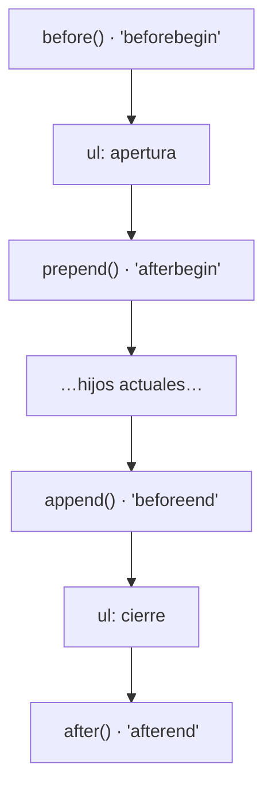

# 4. Modificar el documento

[⬅️ Volver a la unidad](./README.md)

## Índice

- [4.1. Crear elementos](#41-crear-elementos)
  - [4.1.1. `createElement`](#411-createelement)
  - [4.1.2. Plantillas con `<template>`](#412-plantillas-con-template)
- [4.2. Insertar](#42-insertar)
- [4.3. Reemplazar, mover y eliminar](#43-reemplazar-mover-y-eliminar)
- [4.4. Modificar elementos existentes](#44-modificar-elementos-existentes)
  - [4.4.1. Texto y contenido](#441-texto-y-contenido)
  - [4.4.2. Atributos y `dataset`](#442-atributos-y-dataset)
  - [4.4.3. Clases con `classList`](#443-clases-con-classlist)
  - [4.4.4. Estilos](#444-estilos)
- [4.5. Rendimiento: fragmentos y reflujos](#45-rendimiento-fragmentos-y-reflujos)
- [4.6. Qué forma usar](#46-qué-forma-usar)
- [4.7. Ejemplo integrador: tarjetas de productos](#47-ejemplo-integrador-tarjetas-de-productos)
- [Resumen](#resumen)
- [Ejercicios de reflexión](#ejercicios-de-reflexión)

> **CE que trabaja este tema:** RA6 d.

---

## 4.1. Crear elementos

En la UD4 generaste HTML con plantillas de texto e `innerHTML`. La alternativa es **crear los nodos como objetos**: más código, pero sin necesidad de escapar nada y con acceso directo a cada elemento creado.

### 4.1.1. `createElement`

```js
const li = document.createElement('li');   // <li></li>, todavía fuera de la página
li.textContent = 'Pan <integral>';         // texto: nunca se interpreta como HTML
li.className = 'producto';
li.dataset.id = '7';                       // data-id="7"

const boton = document.createElement('button');
boton.textContent = '🗑️';
boton.setAttribute('aria-label', 'Quitar Pan');
li.append(boton);                          // el botón dentro del <li>

document.querySelector('#lista').append(li); // ahora sí, en la página
```

Un elemento creado no aparece hasta que se **inserta** en un elemento que esté en el documento.

> ✅ **Buena práctica**: Con `createElement` + `textContent` **no hay riesgo de XSS**: los datos del usuario nunca se interpretan como HTML. Es la forma más segura de construir elementos con datos externos.

### 4.1.2. Plantillas con `<template>`

Crear elementos uno a uno con `createElement` es seguro pero largo cuando la estructura es grande. El elemento **`<template>`** permite escribir la estructura **en el HTML**, sin que se muestre, y clonarla desde el código cada vez que se necesite.

```html
<template id="plantilla-producto">
  <article class="producto">
    <h2 class="nombre"></h2>
    <p class="precio"></p>
    <button class="anadir">Añadir al carrito</button>
  </article>
</template>
<section id="catalogo"></section>
```

```js
const plantilla = document.querySelector('#plantilla-producto');
const euros = new Intl.NumberFormat('es-ES', { style: 'currency', currency: 'EUR' });

function crearTarjeta({ id, nombre, precio }) {
  const tarjeta = plantilla.content.firstElementChild.cloneNode(true); // copia profunda
  tarjeta.dataset.id = id;
  tarjeta.querySelector('.nombre').textContent = nombre;   // textContent: seguro
  tarjeta.querySelector('.precio').textContent = euros.format(precio);
  return tarjeta;
}

document.querySelector('#catalogo').append(crearTarjeta({ id: 'p1', nombre: 'Lámpara', precio: 34.5 }));
```

- El contenido de un `<template>` **no se muestra** ni se ejecuta; está en `plantilla.content`, un `DocumentFragment` (tema 2).
- `cloneNode(true)` copia el nodo **con todos sus descendientes**.
- La **estructura** queda en el HTML (capa de contenido) y el código solo rellena los datos: es una forma de separar capas (tema 7).

> 💡 **Tip del Examinador**: "¿Para qué sirve `<template>`?" → Para definir en el HTML un fragmento que no se muestra y que el código clona (`template.content.cloneNode(true)`) y rellena cada vez que necesita crear esa estructura.

---

## 4.2. Insertar

| Método | Dónde inserta | Ejemplo |
|--------|---------------|---------|
| `padre.append(…nodos)` | Al final, dentro | `lista.append(li1, li2, 'texto')` |
| `padre.prepend(…nodos)` | Al principio, dentro | `lista.prepend(li)` |
| `elemento.before(…nodos)` | Antes, como hermano | `li.before(nuevo)` |
| `elemento.after(…nodos)` | Después, como hermano | `li.after(nuevo)` |
| `elemento.insertAdjacentElement(posicion, nodo)` | En una de las cuatro posiciones | `'beforebegin'`, `'afterbegin'`, `'beforeend'`, `'afterend'` |
| `padre.appendChild(nodo)` | Al final (forma clásica, un solo nodo) | Código heredado |
| `padre.insertBefore(nodo, referencia)` | Antes de `referencia` (forma clásica) | Código heredado |



El diagrama sitúa las cuatro posiciones respecto a un elemento: antes, al principio de su contenido, al final de su contenido y después.

`append`, `prepend`, `before` y `after` aceptan **varios** nodos y también **textos** (que convierten en nodos de texto).

---

## 4.3. Reemplazar, mover y eliminar

```js
const viejo = document.querySelector('#aviso');
const nuevo = document.createElement('p');
nuevo.textContent = 'Pedido enviado';

viejo.replaceWith(nuevo);                  // reemplazar
document.querySelector('#producto-3').remove(); // eliminar
lista.replaceChildren();                   // vaciar un elemento
lista.replaceChildren(li1, li2);           // sustituir todos sus hijos
```

> ⚠️ **Cuidado**: Un nodo solo puede estar en **un sitio** del árbol. Si haces `append` de un elemento que ya está en la página, **se mueve**, no se copia. Para copiarlo, usa `cloneNode(true)`.

```js
const destacado = document.querySelector('#producto-1');
document.querySelector('#favoritos').append(destacado); // ya no está en el catálogo: se ha movido
```

| Moderno | Clásico (código heredado) |
|---------|---------------------------|
| `elemento.remove()` | `padre.removeChild(elemento)` |
| `viejo.replaceWith(nuevo)` | `padre.replaceChild(nuevo, viejo)` |
| `padre.replaceChildren()` | `padre.innerHTML = ''` o un bucle con `removeChild` |

---

## 4.4. Modificar elementos existentes

### 4.4.1. Texto y contenido

```js
titulo.textContent = 'Novedades';     // sustituye el contenido por texto (seguro)
contenedor.innerHTML = htmlGenerado;  // sustituye por HTML (escapando los datos, UD4)
```

### 4.4.2. Atributos y `dataset`

```js
imagen.src = 'img/lampara.webp';             // propiedad (la mayoría de atributos estándar)
imagen.alt = 'Lámpara de mesa';
boton.disabled = true;                       // atributos booleanos: true o false
campo.setAttribute('aria-invalid', 'true');  // atributos sin propiedad
enlace.removeAttribute('target');
tarjeta.dataset.estado = 'agotado';          // data-estado="agotado"
delete tarjeta.dataset.estado;               // quita data-estado
```

`dataset` convierte los nombres: `data-precio-base` ↔ `dataset.precioBase`. Todos los valores son **texto**.

### 4.4.3. Clases con `classList`

```js
tarjeta.classList.add('destacado', 'nuevo');
tarjeta.classList.remove('nuevo');
tarjeta.classList.toggle('seleccionado');          // añade o quita
tarjeta.classList.toggle('agotado', stock === 0);  // con condición: añade si es true, quita si es false
tarjeta.classList.replace('claro', 'oscuro');
console.log(tarjeta.classList.contains('destacado')); // true
```

### 4.4.4. Estilos

Se puede cambiar el estilo de un elemento con su propiedad `style` y leer el estilo final con `getComputedStyle`:

```js
aviso.style.backgroundColor = '#fff3bf';   // en camelCase: background-color → backgroundColor
document.documentElement.style.setProperty('--color-acento', '#1c7ed6'); // variables CSS (UD4)
console.log(getComputedStyle(aviso).display); // estilo calculado final
```

> ✅ **Buena práctica**: Cambia **clases** (`classList`) o **atributos** (`data-*`, `hidden`) y deja que el CSS decida el aspecto. Usa `style` solo para valores que no se pueden saber de antemano (la posición de algo que se arrastra, un color que elige el usuario), preferiblemente con variables CSS. Lo verás con detalle en el tema 7.

---

## 4.5. Rendimiento: fragmentos y reflujos

Cuando cambias el DOM, el navegador tiene que recalcular la **geometría** de la página (posición y tamaño de cada elemento: el **reflujo** o *reflow*) y volver a **pintar**. Son operaciones caras, así que no las hace después de cada cambio: las **aplaza** hasta que termina tu código y toca pintar, y entonces las hace una sola vez.

Aun así, cada inserción en la página tiene su coste (el navegador anota el cambio, recalcula qué estilos le afectan, avisa a quien vigile esa parte del documento), así que conviene preparar los elementos **fuera** de la página e insertarlos de una vez:

```js
// ⚠️ Funciona, pero cada vuelta modifica la página
for (const p of productos) {
  lista.append(crearTarjeta(p));
}

// ✅ Una sola inserción: se preparan en un fragmento fuera de la página
const fragmento = document.createDocumentFragment();
for (const p of productos) fragmento.append(crearTarjeta(p));
lista.append(fragmento);

// ✅ Equivalente: append acepta varios nodos
lista.append(...productos.map(crearTarjeta));
```

Lo que de verdad hace lento el código es **alternar lecturas y escrituras** de geometría. Si lees `offsetWidth`, `offsetHeight` o `getBoundingClientRect()` después de un cambio, el navegador ya no puede aplazar el reflujo: lo hace **en ese momento** para darte el dato (un **reflujo forzado**).

```js
// cajas es un array de elementos
// ❌ Lee y escribe en cada vuelta: un reflujo forzado por elemento
for (const caja of cajas) caja.style.height = `${caja.offsetWidth / 2}px`;

// ✅ Primero todas las lecturas, después todas las escrituras: un solo reflujo
const anchos = cajas.map((caja) => caja.offsetWidth);
cajas.forEach((caja, i) => (caja.style.height = `${anchos[i] / 2}px`));
```

> 📝 **Nota del Profesor**: Con decenas de elementos no notarás la diferencia; con miles, sí. El hábito de preparar los nodos fuera de la página e insertarlos de una vez sale gratis y evita problemas cuando la aplicación crece.

---

## 4.6. Qué forma usar

| Situación | Forma recomendada |
|-----------|-------------------|
| Pocos elementos sencillos | `createElement` + `textContent` |
| Estructura repetida y compleja (tarjetas, filas) | `<template>` + `cloneNode(true)` |
| Mucho HTML generado de datos propios, sin interacción por elemento | Plantilla de texto + `innerHTML`, escapando (UD4) |
| Muchos elementos a la vez | Prepararlos en un `DocumentFragment` o con `append(...nodos)` |
| Cambiar el aspecto | `classList` y `data-*`, no `style` |

---

## 4.7. Ejemplo integrador: tarjetas de productos

Un catálogo que se pinta desde un array con `<template>`, marca los agotados con una clase, permite marcar favoritos y se vuelve a pintar entero al filtrar.

```html
<label><input type="checkbox" id="solo-disponibles" /> Solo disponibles</label>
<section id="catalogo"></section>
<template id="plantilla-producto">
  <article class="producto">
    <h2 class="nombre"></h2>
    <p class="precio"></p>
    <button class="favorito" aria-pressed="false">☆</button>
  </article>
</template>
```

```js
// catalogo.js
const PRODUCTOS = [
  { id: 'p1', nombre: 'Lámpara', precio: 34.5, stock: 3 },
  { id: 'p2', nombre: 'Teclado <mecánico>', precio: 59, stock: 0 },
  { id: 'p3', nombre: 'Ratón', precio: 12, stock: 10 },
];
const euros = new Intl.NumberFormat('es-ES', { style: 'currency', currency: 'EUR' });
const plantilla = document.querySelector('#plantilla-producto');
const catalogo = document.querySelector('#catalogo');
const favoritos = new Set();

function crearTarjeta({ id, nombre, precio, stock }) {
  const tarjeta = plantilla.content.firstElementChild.cloneNode(true);
  tarjeta.dataset.id = id;
  tarjeta.classList.toggle('agotado', stock === 0);
  tarjeta.querySelector('.nombre').textContent = nombre;
  tarjeta.querySelector('.precio').textContent = stock === 0 ? 'Agotado' : euros.format(precio);
  const boton = tarjeta.querySelector('.favorito');
  boton.setAttribute('aria-pressed', String(favoritos.has(id)));
  boton.textContent = favoritos.has(id) ? '★' : '☆';
  return tarjeta;
}

function pintar() {
  const soloDisponibles = document.querySelector('#solo-disponibles').checked;
  const visibles = PRODUCTOS.filter((p) => !soloDisponibles || p.stock > 0);
  catalogo.replaceChildren(...visibles.map(crearTarjeta)); // una sola operación
}

catalogo.addEventListener('click', (evento) => {
  const boton = evento.target.closest('.favorito');
  if (!boton) return;
  const id = boton.closest('.producto').dataset.id;
  if (favoritos.has(id)) favoritos.delete(id);
  else favoritos.add(id);
  pintar();
});
document.querySelector('#solo-disponibles').addEventListener('change', pintar);
pintar();
```

| Técnica | Dónde |
|---------|-------|
| Estructura en el HTML con `<template>` | `#plantilla-producto` |
| Clonar y rellenar con `textContent` | `crearTarjeta` (el nombre con `<mecánico>` se ve como texto) |
| Clases con condición | `classList.toggle('agotado', stock === 0)` |
| Atributos de accesibilidad y `data-*` | `aria-pressed`, `dataset.id` |
| Sustituir todos los hijos de una vez | `replaceChildren(...)` |
| Subir desde el elemento pulsado | `closest('.favorito')`, `closest('.producto')` |

---

## Resumen

- `document.createElement(etiqueta)` crea un elemento fuera de la página; se rellena con `textContent` (seguro) y se inserta después.
- `<template>` guarda en el HTML una estructura que no se muestra; se usa con `template.content.firstElementChild.cloneNode(true)`.
- Se inserta con `append`, `prepend`, `before`, `after` (o los clásicos `appendChild` e `insertBefore`); se reemplaza con `replaceWith` y `replaceChildren`, y se elimina con `remove`.
- Un nodo solo está en un sitio: insertarlo de nuevo lo **mueve**; para copiarlo, `cloneNode(true)`.
- Los atributos se cambian con propiedades, `setAttribute` y `dataset`; las clases con `classList` (`add`, `remove`, `toggle`, `replace`, `contains`).
- El aspecto se cambia con clases y atributos; `style` solo para valores dinámicos.
- Para el rendimiento: preparar en un `DocumentFragment` e insertar una vez, y separar lecturas y escrituras de geometría.

## Ejercicios de reflexión

1. Crea un `<a>` que apunte a `https://developer.mozilla.org`, se abra en otra pestaña de forma segura (UD4) y tenga el texto «MDN», solo con métodos del DOM.
2. ¿Qué pasa si haces `lista.append(elemento)` con un `elemento` que ya estaba en otra lista? ¿Cómo lo copiarías?
3. Compara `createElement`, `<template>` e `innerHTML` para crear 100 tarjetas con datos del usuario: seguridad, cantidad de código y separación de capas.
4. ¿Por qué `classList.toggle('agotado', stock === 0)` es mejor que un `if` con `add` y `remove`?
5. Explica qué es un reflujo y por qué un bucle que lee `offsetWidth` y cambia `style.height` en cada vuelta es lento.

---

[⬅️ Volver a la unidad](./README.md)
