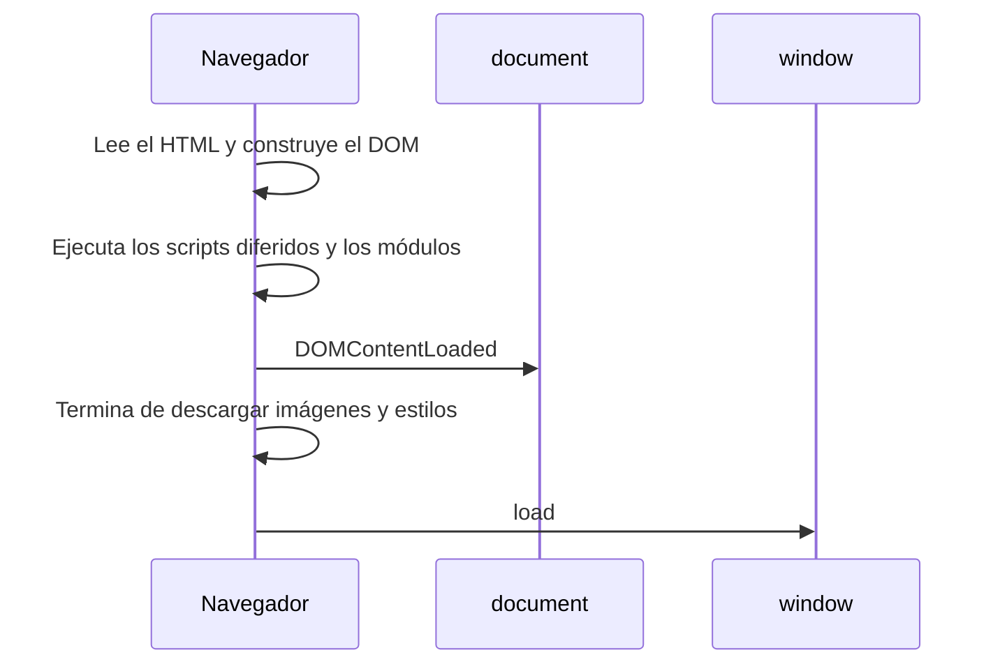

# 5. Eventos del modelo

[⬅️ Volver a la unidad](./README.md)

## Índice

- [5.1. Qué es un evento](#51-qué-es-un-evento)
- [5.2. `addEventListener`](#52-addeventlistener)
  - [5.2.1. El objeto evento](#521-el-objeto-evento)
  - [5.2.2. Quitar un oyente](#522-quitar-un-oyente)
- [5.3. Formas antiguas de asociar eventos](#53-formas-antiguas-de-asociar-eventos)
- [5.4. Eventos frecuentes](#54-eventos-frecuentes)
- [5.5. Los eventos de carga: `DOMContentLoaded` y `load`](#55-los-eventos-de-carga-domcontentloaded-y-load)
- [5.6. Elementos creados después: delegación](#56-elementos-creados-después-delegación)
- [5.7. Ejemplo integrador: contador de caracteres](#57-ejemplo-integrador-contador-de-caracteres)
- [Resumen](#resumen)
- [Ejercicios de reflexión](#ejercicios-de-reflexión)

> **CE que trabaja este tema:** RA6 e.

---

## 5.1. Qué es un evento

Un **evento** es algo que **ocurre** en la página: el usuario pulsa un botón, escribe en un campo, la página termina de cargar, un vídeo se acaba. El navegador lo **notifica** al nodo donde ha ocurrido (y, como verás en el apartado 5.6, a sus ascendientes), y cada uno ejecuta las funciones que tenga **suscritas** a ese evento: los **manejadores** u **oyentes** (*event listeners*).

Es el patrón **Observer** de la UD3: el nodo es el sujeto (`EventTarget`, tema 2) y las funciones suscritas son los observadores.

```js
const boton = document.querySelector('#saludar');
boton.addEventListener('click', () => {
  console.log('¡Hola!');
});
```

> 📝 **Nota del Profesor**: Este tema es una **introducción**: lo justo para asociar acciones a los elementos que creas y modificas con el DOM. La **UD6** estudia los eventos a fondo: propagación (burbuja y captura), `preventDefault`, eventos de teclado y ratón, y formularios.

---

## 5.2. `addEventListener`

```js
elemento.addEventListener(tipo, oyente, opciones);
```

| Parámetro | Qué es | Ejemplo |
|-----------|--------|---------|
| `tipo` | Nombre del evento, sin `on` | `'click'`, `'input'`, `'submit'` |
| `oyente` | Función que se ejecuta; recibe el objeto evento | `(evento) => { … }` |
| `opciones` | Opcional: `{ once: true }` (una sola vez), `{ passive: true }`… | `{ once: true }` |

Un mismo elemento puede tener **varios oyentes** para el mismo evento: se ejecutan en el orden en que se añadieron.

### 5.2.1. El objeto evento

El oyente recibe un objeto con información del evento:

| Propiedad | Qué es |
|-----------|--------|
| `evento.type` | El tipo (`'click'`) |
| `evento.target` | El elemento **donde ocurrió** (el más interno: el `<span>` dentro del botón, por ejemplo) |
| `evento.currentTarget` | El elemento **al que está asociado** el oyente |
| `evento.timeStamp` | Cuándo ocurrió |

```js
document.querySelector('#lista').addEventListener('click', (evento) => {
  console.log(evento.target.tagName);        // 'BUTTON', 'LI'… lo que se pulsó
  console.log(evento.currentTarget.id);      // 'lista': siempre el del oyente
});
```

> ⚠️ **Cuidado**: Dentro de un oyente escrito con `function`, `this` es `currentTarget`; con una flecha, `this` es el de fuera (UD3). Usa `evento.currentTarget` y te olvidas del problema.

### 5.2.2. Quitar un oyente

Para quitarlo con `removeEventListener` hace falta **la misma función** (la misma referencia), así que no puede ser anónima:

```js
function alPulsar() {
  console.log('Pulsado');
}
boton.addEventListener('click', alPulsar);
boton.removeEventListener('click', alPulsar); // funciona

boton.addEventListener('click', () => console.log('Pulsado'));
boton.removeEventListener('click', () => console.log('Pulsado')); // ❌ no quita nada: es otra función
```

Si el oyente solo debe ejecutarse una vez, `{ once: true }` lo quita solo.

---

## 5.3. Formas antiguas de asociar eventos

| Forma | Ejemplo | Problema |
|-------|---------|----------|
| Atributo en el HTML | `<button onclick="guardar()">` | Mezcla comportamiento y contenido; solo ve funciones globales (no funciona con módulos) |
| Propiedad `on…` | `boton.onclick = guardar;` | Solo admite **un** oyente: el segundo sustituye al primero |
| **`addEventListener`** | `boton.addEventListener('click', guardar)` | ✅ Varios oyentes, opciones, separación de capas |

```js
boton.onclick = () => console.log('uno');
boton.onclick = () => console.log('dos'); // el primero se pierde: solo se muestra 'dos'
```

> 💡 **Tip del Examinador**: "¿Por qué se prefiere `addEventListener` a `onclick`?" → Porque permite varios oyentes para el mismo evento, admite opciones (`once`…) y se escribe en el JavaScript, sin mezclarlo con el HTML. Los atributos `onclick` del HTML, además, no ven las funciones de los módulos.

---

## 5.4. Eventos frecuentes

| Evento | Cuándo | Dónde |
|--------|--------|-------|
| `click` | Se pulsa (ratón, dedo o tecla Intro/espacio en un botón) | Cualquier elemento |
| `input` | Cambia el valor mientras se escribe | `<input>`, `<textarea>`, `<select>` |
| `change` | El valor cambia y se confirma (al salir del campo, al marcar una casilla) | Campos de formulario |
| `submit` | Se envía un formulario | `<form>` |
| `keydown`, `keyup` | Se pulsa o suelta una tecla | Elemento con el foco, `document` |
| `focus`, `blur` | Un elemento gana o pierde el foco | Campos, botones, enlaces |
| `mouseenter`, `mouseleave` | El puntero entra o sale | Cualquier elemento |
| `DOMContentLoaded`, `load` | La página está lista (apartado 5.5) | `document`, `window` |

```js
document.querySelector('#busqueda').addEventListener('input', (evento) => {
  console.log(`Buscando: ${evento.target.value}`);
});
```

> ✅ **Buena práctica**: Para acciones del usuario usa elementos **interactivos** de verdad (`<button>`, `<a>`, `<input>`), no un `<div>` con `click`: los botones se pueden usar con el teclado y los lectores de pantalla los anuncian.

---

## 5.5. Los eventos de carga: `DOMContentLoaded` y `load`

| Evento | Se lanza cuando… | Sobre |
|--------|------------------|-------|
| `DOMContentLoaded` | El HTML está leído y el **DOM construido** (las imágenes pueden no haber cargado) | `document` |
| `load` | Ha cargado **todo**: imágenes, hojas de estilo, marcos | `window` |



El diagrama muestra el orden: los módulos se ejecutan con el DOM ya construido, antes de `DOMContentLoaded`; `load` llega al final.

```js
// Necesario solo si el script se ejecuta antes de que exista el DOM (un <script> clásico en el <head>)
document.addEventListener('DOMContentLoaded', () => {
  document.querySelector('h1').textContent = 'Listo';
});

// Para algo que necesita las imágenes cargadas (por ejemplo, medir su tamaño)
window.addEventListener('load', () => {
  console.log(document.querySelector('img').naturalWidth);
});
```

> 📝 **Nota del Profesor**: Con `<script type="module">` (lo habitual en el curso) el DOM ya está construido cuando se ejecuta tu código: **no necesitas** `DOMContentLoaded`. Lo verás en código heredado y en scripts clásicos.

---

## 5.6. Elementos creados después: delegación

Si asocias un oyente a cada `<li>` al cargar la página, los `<li>` que crees **después** no lo tendrán. Hay dos soluciones:

1. Añadir el oyente a cada elemento **al crearlo** (en la función que lo crea).
2. **Delegación de eventos**: un **único** oyente en el contenedor, que averigua con `evento.target` y `closest` sobre qué elemento se actuó.

```js
// Un solo oyente para todos los botones de la lista, presentes y futuros
document.querySelector('#lista').addEventListener('click', (evento) => {
  const boton = evento.target.closest('button.quitar');
  if (!boton) return;                 // el clic no fue en un botón de quitar
  boton.closest('li').remove();
});
```

Funciona porque el evento `click` **sube** (*bubbles*) desde el elemento pulsado hasta sus ascendientes: el contenedor lo recibe aunque se haya pulsado un botón dentro. La propagación se estudia en la UD6.

> 💡 **Tip del Examinador**: "¿Qué es la delegación de eventos y qué ventaja tiene?" → Asociar un único oyente a un contenedor y averiguar con `event.target` (y `closest`) qué hijo se pulsó. Sirve para los elementos que se crean después y evita añadir un oyente a cada uno.

---

## 5.7. Ejemplo integrador: contador de caracteres

Cualquier `<textarea>` con el atributo `data-maximo` muestra debajo los caracteres que le quedan, y cambia de aspecto cuando se acerca al límite. El HTML solo declara qué campos lo tienen; el código crea los contadores.

```html
<label for="comentario">Comentario</label>
<textarea id="comentario" data-maximo="140"></textarea>

<label for="bio">Biografía</label>
<textarea id="bio" data-maximo="300"></textarea>
```

```css
.contador { font-size: 0.85em; color: #868e96; }
.contador.cerca { color: #e67700; }
.contador.excedido { color: #c92a2a; font-weight: 700; }
```

```js
// contador.js
for (const campo of document.querySelectorAll('textarea[data-maximo]')) {
  const maximo = Number(campo.dataset.maximo);
  const contador = document.createElement('p');
  contador.className = 'contador';
  contador.id = `${campo.id}-contador`;
  contador.setAttribute('aria-live', 'polite');
  campo.setAttribute('aria-describedby', contador.id); // el lector de pantalla lo asocia al campo
  campo.after(contador);

  const actualizar = () => {
    const quedan = maximo - campo.value.length;
    contador.textContent = quedan >= 0 ? `Quedan ${quedan} caracteres` : `Te sobran ${-quedan} caracteres`;
    contador.classList.toggle('cerca', quedan >= 0 && quedan <= maximo * 0.1);
    contador.classList.toggle('excedido', quedan < 0);
  };
  campo.addEventListener('input', actualizar);
  actualizar();
}
```

| Técnica | Dónde |
|---------|-------|
| Seleccionar por atributo `data-*` | `textarea[data-maximo]` |
| Crear e insertar elementos | `createElement` + `after` |
| Asociar acciones a eventos | `addEventListener('input', …)` |
| Cambiar el aspecto con clases | `classList.toggle('cerca', …)` |
| Accesibilidad | `aria-describedby`, `aria-live` |

---

## Resumen

- Un **evento** es algo que ocurre en la página; los nodos (`EventTarget`) avisan a sus **oyentes** (patrón Observer).
- `addEventListener(tipo, oyente, opciones)` asocia una acción; admite varios oyentes y opciones como `{ once: true }`. `removeEventListener` necesita la misma función.
- El objeto evento trae `type`, `target` (donde ocurrió) y `currentTarget` (donde está el oyente).
- `onclick` en el HTML o como propiedad es la forma antigua: mezcla capas o solo admite un oyente.
- Eventos frecuentes: `click`, `input`, `change`, `submit`, `keydown`, `focus`, `blur`.
- `DOMContentLoaded` (DOM listo) y `load` (todo cargado). Con módulos no hace falta esperar a `DOMContentLoaded`.
- La **delegación**: un oyente en el contenedor y `closest` sirven también para los elementos creados después.

## Ejercicios de reflexión

1. ¿Qué diferencia hay entre `evento.target` y `evento.currentTarget` si pulsas un `<span>` que está dentro del `<button>` que tiene el oyente?
2. Escribe dos veces `boton.onclick = …` con funciones distintas y después dos `addEventListener`. ¿Qué se ejecuta en cada caso?
3. ¿Por qué un `<button onclick="guardar()">` no funciona si `guardar` está en un módulo?
4. Añade un oyente a cada `<li>` al cargar la página y crea después un `<li>` nuevo. ¿Responde al clic? ¿Cómo lo solucionas?
5. ¿En qué orden se ejecutan un módulo, `DOMContentLoaded` y `load`? Compruébalo con tres `console.log`.

---

[⬅️ Volver a la unidad](./README.md)
