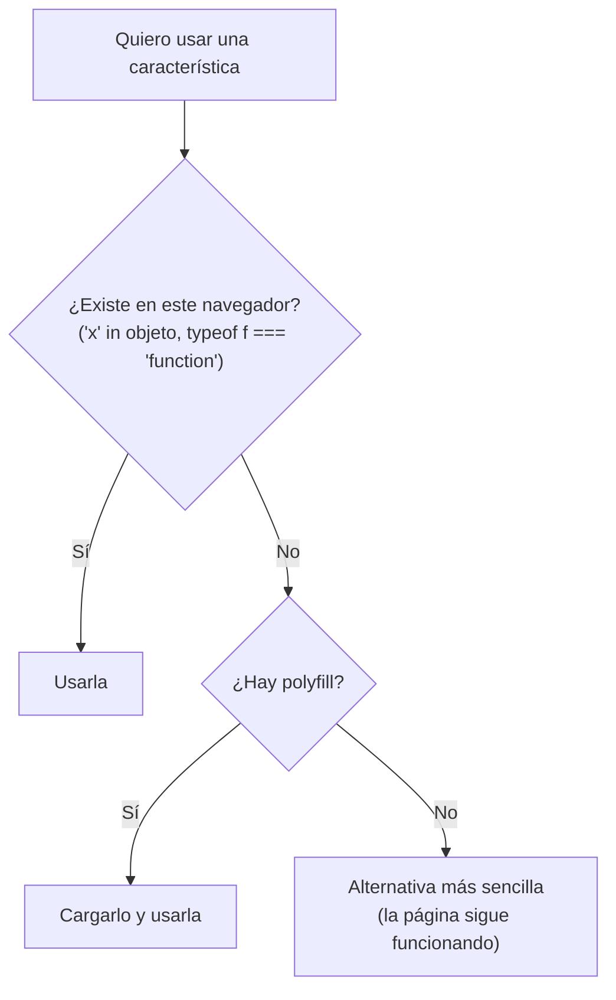

# 6. Compatibilidad entre navegadores

[⬅️ Volver a la unidad](./README.md)

## Índice

- [6.1. Un modelo, varias implementaciones](#61-un-modelo-varias-implementaciones)
- [6.2. Un poco de historia: el modelo de Internet Explorer](#62-un-poco-de-historia-el-modelo-de-internet-explorer)
- [6.3. Las diferencias de hoy](#63-las-diferencias-de-hoy)
- [6.4. Saber qué funciona dónde](#64-saber-qué-funciona-dónde)
  - [6.4.1. Baseline](#641-baseline)
  - [6.4.2. MDN y caniuse](#642-mdn-y-caniuse)
- [6.5. Detección de características](#65-detección-de-características)
- [6.6. Mejora progresiva](#66-mejora-progresiva)
- [6.7. Polyfills y transpilación](#67-polyfills-y-transpilación)
- [6.8. Probar en varios motores con Playwright](#68-probar-en-varios-motores-con-playwright)
- [6.9. Ejemplo integrador: un diálogo que funciona en todas partes](#69-ejemplo-integrador-un-diálogo-que-funciona-en-todas-partes)
- [Resumen](#resumen)
- [Ejercicios de reflexión](#ejercicios-de-reflexión)

> **CE que trabaja este tema:** RA6 f, g.

---

## 6.1. Un modelo, varias implementaciones

El DOM es un **estándar**, pero cada navegador lo **implementa** con su propio motor:

| Motor de renderizado | Motor de JavaScript | Navegadores |
|----------------------|---------------------|-------------|
| **Blink** | V8 | Chrome, Edge, Opera, Brave, Samsung Internet |
| **Gecko** | SpiderMonkey | Firefox |
| **WebKit** | JavaScriptCore | Safari y, en iOS, casi todos los navegadores, también Chrome y Firefox (Apple solo permite otros motores en algunos países) |

Cada motor añade las novedades del estándar a su ritmo y puede tener errores propios. Por eso una página puede funcionar en Chrome y fallar en Safari. Los CE f y g piden **identificar** esas diferencias y **programar** para que la aplicación funcione igualmente.

---

## 6.2. Un poco de historia: el modelo de Internet Explorer

Durante los años 2000, Internet Explorer tenía su **propio modelo** de DOM y de eventos, incompatible con el estándar. El código tenía que comprobar el navegador en cada paso:

```js
// Código heredado de la época de Internet Explorer (no lo escribas así)
function anadirEvento(elemento, tipo, oyente) {
  if (elemento.addEventListener) {
    elemento.addEventListener(tipo, oyente, false); // estándar
  } else if (elemento.attachEvent) {
    elemento.attachEvent('on' + tipo, oyente);      // Internet Explorer 8 y anteriores
  }
}
var objetivo = evento.target || evento.srcElement;  // en IE, el elemento estaba en srcElement
```

| Estándar | Internet Explorer antiguo |
|----------|---------------------------|
| `addEventListener('click', f)` | `attachEvent('onclick', f)` |
| `evento.target` | `window.event.srcElement` |
| `evento.preventDefault()` | `evento.returnValue = false` |
| `textContent` | `innerText` |

De esa época nacieron librerías como **jQuery** (2006), cuyo éxito se debió en gran parte a que escondía estas diferencias tras una sola API. Hoy Internet Explorer está retirado, los navegadores siguen el estándar del WHATWG y jQuery ya no es necesario para esto.

> 📝 **Nota del Profesor**: No vas a programar para Internet Explorer, pero sí vas a encontrar este código en proyectos antiguos. Saber de dónde viene te permite reconocerlo y sustituirlo por la forma estándar.

---

## 6.3. Las diferencias de hoy

Hoy los navegadores coinciden en lo esencial del DOM. Las diferencias aparecen sobre todo en:

- **Novedades recientes**: una API nueva puede estar en Chrome y Firefox y llegar meses después a Safari (o al revés).
- **APIs que dependen del dispositivo o de permisos**: `navigator.share` (sobre todo en móviles), `Notification`, el portapapeles…
- **Comportamientos de detalle**: el foco, el estilo por defecto de los controles de formulario, los eventos táctiles.
- **Errores** puntuales de un motor.
- **Navegadores desactualizados**: equipos o móviles que no se actualizan.

```js
// Algunas APIs que no están (o no han estado) en todos los navegadores a la vez
'share' in navigator;              // sobre todo móviles
typeof HTMLDialogElement;          // <dialog> llegó a Safari en 2022
typeof Element.prototype.checkVisibility; // Baseline desde 2024
```

---

## 6.4. Saber qué funciona dónde

### 6.4.1. Baseline

**Baseline** es una iniciativa conjunta de los fabricantes de navegadores (a través del grupo WebDX del W3C) que indica, de forma sencilla, si una característica se puede usar con tranquilidad:

| Estado | Significado |
|--------|-------------|
| **Disponible ampliamente** (*Widely available*) | Funciona en las últimas versiones de Chrome, Edge, Firefox y Safari desde hace al menos 30 meses |
| **Disponible recientemente** (*Newly available*) | Acaba de llegar al último de esos navegadores: funciona en los actualizados, pero no en los antiguos |
| **Disponibilidad limitada** | Aún no está en todos |

MDN muestra la insignia Baseline al principio de la ficha de cada API.

### 6.4.2. MDN y caniuse

- **MDN** (<https://developer.mozilla.org>): al final de cada ficha, la tabla **Compatibilidad con navegadores** dice desde qué versión funciona en cada uno.
- **caniuse** (<https://caniuse.com>): busca una característica y muestra el porcentaje de usuarios cuyos navegadores la soportan.

> ✅ **Buena práctica**: Antes de usar una API que no conoces, mira su insignia Baseline o su tabla de compatibilidad. Si es «Disponible ampliamente», úsala sin más. Si no, prevé una **alternativa** (apartados 6.5 a 6.7).

> 💡 **Tip del Examinador**: "¿Cómo sabes si puedes usar una API del DOM en todos los navegadores?" → Consultando su estado Baseline o la tabla de compatibilidad de MDN o caniuse. Si no está disponible en todos, se detecta en el código y se ofrece una alternativa.

---

## 6.5. Detección de características

Como viste en la UD4 con `navigator`, la forma de programar para varios navegadores es **detectar la característica**, no el navegador:

```js
if ('showModal' in HTMLDialogElement.prototype) {
  dialogo.showModal();
} else {
  // alternativa para navegadores sin <dialog>
}
```



El diagrama resume la estrategia: comprobar, usar si existe y, si no, cargar un polyfill o recurrir a una alternativa que mantenga lo esencial.

Formas de detectar:

| Qué | Cómo |
|-----|------|
| Una propiedad o API de un objeto | `'clipboard' in navigator`, `'IntersectionObserver' in window` |
| Un método de un tipo de elemento | `'showModal' in HTMLDialogElement.prototype` |
| Una función global | `typeof structuredClone === 'function'` |
| Soporte de una propiedad CSS | `CSS.supports('display', 'grid')` en JavaScript, o la regla `@supports (display: grid) { … }` en el propio CSS |
| Un tipo de `<input>` | Crear uno y comprobar si conserva el `type` |

```js
// ¿Soporta el navegador <input type="date">?
function soportaTipoInput(tipo) {
  const campo = document.createElement('input');
  campo.setAttribute('type', tipo);
  return campo.type === tipo; // si no lo soporta, el navegador lo deja en 'text'
}
```

> ⚠️ **Cuidado**: Detecta lo que **vas a usar**, justo eso. Comprobar que existe `fetch` no garantiza que exista `AbortController`.

---

## 6.6. Mejora progresiva

La **mejora progresiva** (*progressive enhancement*) es una forma de construir que garantiza que la página funciona en todos los navegadores:

1. Una **base** de HTML semántico que funciona sola (enlaces, formularios que se envían, contenido visible).
2. **CSS** que mejora el aspecto.
3. **JavaScript** que mejora la experiencia, **detectando** lo que usa.

Si el JavaScript falla o una API no existe, el usuario sigue teniendo la versión básica.

```html
<!-- Base: un enlace que funciona siempre -->
<a href="ayuda.html" id="ayuda">Ayuda</a>
```

```js
// Mejora: si hay <dialog>, se muestra la ayuda sin salir de la página
const enlace = document.querySelector('#ayuda');
if ('showModal' in HTMLDialogElement.prototype) {
  enlace.addEventListener('click', (evento) => {
    evento.preventDefault(); // no seguir el enlace: se usa el diálogo (UD6)
    document.querySelector('#dialogo-ayuda').showModal();
  });
}
```

| Mejora progresiva | Degradación elegante (*graceful degradation*) |
|-------------------|-----------------------------------------------|
| Se parte de lo básico y se añade | Se parte de lo completo y se prevé qué hacer si algo falla |
| Funciona en todos por diseño | Funciona en todos si se han previsto los fallos |

> 💡 **Tip del Examinador**: "¿Qué es la mejora progresiva?" → Construir primero una versión básica que funcione en cualquier navegador (HTML semántico) y añadir encima mejoras de CSS y JavaScript que solo se activan si el navegador las soporta.

---

## 6.7. Polyfills y transpilación

- Un **polyfill** es código que **implementa** una API que falta, con la misma interfaz que la estándar. Si el navegador ya la tiene, no hace nada.

  ```js
  // Polyfill mínimo de Array.prototype.at (ES2022)
  if (!Array.prototype.at) {
    Array.prototype.at = function (indice) {
      const i = Math.trunc(indice) || 0;
      return this[i < 0 ? this.length + i : i];
    };
  }
  ```

- La **transpilación** convierte **sintaxis** moderna que un navegador antiguo no entiende (por ejemplo, `??` o los campos `#`) en sintaxis antigua equivalente. La hacen herramientas como **Babel**, **esbuild** o el empaquetador de **Vite**, configurando qué navegadores se quieren soportar.

| | Polyfill | Transpilación |
|---|---|---|
| Resuelve | APIs que faltan (`structuredClone`, `Array.prototype.at`) | Sintaxis que no se entiende (`?.`, `#privado`, `class`) |
| Cuándo actúa | Al ejecutar, en el navegador | Al construir el proyecto, antes de publicarlo |
| Herramientas | `core-js`, polyfills sueltos | Babel, esbuild, Vite (`build.target`) |

> 📝 **Nota del Profesor**: Ya no se añaden polyfills "por si acaso": aumentan el tamaño de la página. Se deciden en función de los navegadores que hay que soportar (Baseline ayuda). En este curso, la versión de referencia es ES2025 y los navegadores actualizados, así que rara vez los necesitarás; pero en una empresa con clientes que usan equipos antiguos, sí.

---

## 6.8. Probar en varios motores con Playwright

Comprobar una aplicación a mano en Chrome, Firefox y Safari es lento. **Playwright** es una herramienta de pruebas que abre la página en los tres motores (**Chromium**, **Firefox** y **WebKit**) y ejecuta en cada uno las mismas pruebas, de forma automática.

```js
// e2e/pagina.spec.js
import { test, expect } from '@playwright/test';

test('el diálogo de ayuda se abre', async ({ page }) => {
  await page.goto('/'); // la dirección de baseURL
  await page.getByRole('link', { name: 'Ayuda' }).click();
  await expect(page.getByRole('dialog')).toBeVisible();
});
```

```js
// playwright.config.js
import { defineConfig, devices } from '@playwright/test';

export default defineConfig({
  testDir: 'e2e',
  use: { baseURL: 'http://localhost:3000' },
  // Arranca el servidor de la página antes de las pruebas (o usa el que ya esté en marcha)
  webServer: {
    command: 'npx --yes serve@14.2.6 --no-clipboard --listen 3000 .',
    url: 'http://localhost:3000',
    reuseExistingServer: true,
  },
  projects: [
    { name: 'chromium', use: { ...devices['Desktop Chrome'] } },
    { name: 'firefox', use: { ...devices['Desktop Firefox'] } },
    { name: 'webkit', use: { ...devices['Desktop Safari'] } },
  ],
});
```

```bash
npm install -D @playwright/test
npx playwright install --with-deps   # descarga los tres navegadores (la primera vez)
npx playwright test                  # ejecuta las pruebas en los tres
```

- `async` y `await` (UD7) aparecen porque cada acción espera a que el navegador termine.
- `getByRole` busca los elementos como los encuentra un usuario (por su función y su texto accesible), no por clases.
- Es un tipo de prueba distinto de los tests unitarios de Vitest: prueba la **página entera** en un **navegador real** (prueba de extremo a extremo o *end-to-end*, UD1).

> 📝 **Nota del Profesor**: Playwright descarga navegadores reales (varios cientos de megas) y, en Linux, las librerías del sistema que necesita cada uno (`--with-deps` las instala). No hace falta ver la ventana: por defecto los ejecuta sin interfaz (*headless*). Lo usarás en el ejercicio E08, cuyo Dev Container ya trae los tres navegadores, y desde el tema 8 en los ejercicios que tienen tests, que también lo ejecutan en GitHub Actions en su apartado opcional de integración continua.

---

## 6.9. Ejemplo integrador: un diálogo que funciona en todas partes

Un aviso que usa `<dialog>` si el navegador lo tiene y, si no, una alternativa con un elemento normal y el atributo `hidden`. El resto del código usa siempre la misma función.

```js
// aviso.js
const soportaDialog = typeof HTMLDialogElement === 'function' && 'showModal' in HTMLDialogElement.prototype;

/**
 * Muestra un aviso modal. Usa <dialog> si existe; si no, un contenedor con `hidden`.
 * @param {HTMLElement} contenedor El <dialog> (o el elemento alternativo).
 * @param {string} texto
 */
export function mostrarAviso(contenedor, texto) {
  contenedor.querySelector('.texto').textContent = texto;
  if (soportaDialog && contenedor instanceof HTMLDialogElement) {
    contenedor.showModal();
  } else {
    contenedor.hidden = false;      // alternativa: mostrar el elemento
    contenedor.classList.add('modal-alternativo');
    contenedor.querySelector('button').focus();
  }
}

/** @param {HTMLElement} contenedor */
export function cerrarAviso(contenedor) {
  if (soportaDialog && contenedor instanceof HTMLDialogElement) contenedor.close();
  else contenedor.hidden = true;
}
```

| CE | Dónde |
|----|-------|
| f · Identificar diferencias | Saber que `<dialog>` no está en navegadores antiguos (consultado en Baseline/MDN) |
| g · Funcionar con implementaciones distintas | Detección con `'showModal' in HTMLDialogElement.prototype` y alternativa con `hidden` |

---

## Resumen

- Cada navegador implementa el DOM con su **motor**: Blink (Chrome, Edge), Gecko (Firefox) y WebKit (Safari).
- Internet Explorer tenía un modelo propio (`attachEvent`, `srcElement`); de ahí venían el código con ramas por navegador y el éxito de jQuery.
- Hoy las diferencias están en las **novedades**, las APIs que dependen del dispositivo y los navegadores desactualizados.
- **Baseline**, **MDN** y **caniuse** dicen qué funciona dónde.
- Se programa con **detección de características** (nunca del navegador), **mejora progresiva**, **polyfills** (APIs que faltan) y **transpilación** (sintaxis nueva).
- **Playwright** ejecuta las mismas pruebas en Chromium, Firefox y WebKit.

## Ejercicios de reflexión

1. Busca en MDN `Element.checkVisibility()` y `structuredClone()`. ¿Qué estado Baseline tiene cada uno? ¿Los usarías sin alternativa?
2. Reescribe con la forma estándar el código heredado del apartado 6.2.
3. Escribe una detección de características para `navigator.share` y una alternativa que copie el enlace al portapapeles.
4. ¿Qué diferencia hay entre un polyfill y un transpilador? ¿Cuál necesitarías para usar `?.` en un navegador antiguo?
5. ¿Por qué no basta con probar una página en Chrome y en Edge para estar seguro de que funciona en todos los navegadores?

---

[⬅️ Volver a la unidad](./README.md)
