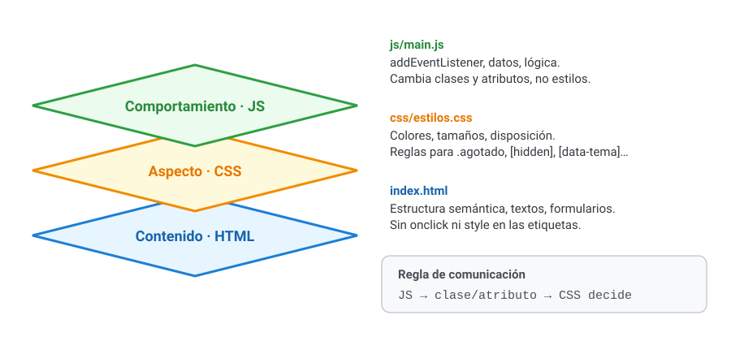
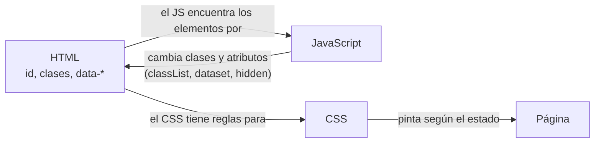

# 7. Separación de capas

[⬅️ Volver a la unidad](./README.md)

## Índice

- [7.1. Las tres capas de una aplicación web](#71-las-tres-capas-de-una-aplicación-web)
- [7.2. Contenido: HTML semántico](#72-contenido-html-semántico)
- [7.3. Aspecto: el CSS decide](#73-aspecto-el-css-decide)
- [7.4. Comportamiento: JavaScript no obstructivo](#74-comportamiento-javascript-no-obstructivo)
- [7.5. Cómo se comunican las capas](#75-cómo-se-comunican-las-capas)
- [7.6. Estructura de carpetas](#76-estructura-de-carpetas)
- [7.7. Refactorizar a tres capas](#77-refactorizar-a-tres-capas)
- [7.8. Ejemplo integrador: acordeón de preguntas frecuentes](#78-ejemplo-integrador-acordeón-de-preguntas-frecuentes)
- [Resumen](#resumen)
- [Ejercicios de reflexión](#ejercicios-de-reflexión)

> **CE que trabaja este tema:** RA6 h.

---

## 7.1. Las tres capas de una aplicación web

Una página web tiene tres responsabilidades distintas, y cada una tiene su lenguaje:



La imagen muestra las tres capas apiladas y qué va en cada fichero: el contenido es la base, el aspecto se aplica encima y el comportamiento actúa sobre los dos sin mezclarse con ellos.

| Capa | Lenguaje | Responde a | Fichero |
|------|----------|-----------|---------|
| **Contenido** (estructura) | HTML | ¿Qué es cada cosa? | `index.html` |
| **Aspecto** (presentación) | CSS | ¿Cómo se ve? | `css/estilos.css` |
| **Comportamiento** | JavaScript | ¿Qué hace? | `js/main.js` |

**Independizarlas** (CE h) significa que cada capa está en su fichero y que se puede cambiar una sin tocar las otras: un diseñador cambia los colores sin abrir el JavaScript; un programador cambia la lógica sin tocar el HTML.

> 📝 **Nota del Profesor**: Ya lo viste en la UD1 y lo has aplicado desde entonces (las convenciones del curso prohíben `onclick` y `style` en línea). En este tema lo ves como una técnica con nombre, y en el ejercicio E06 refactorizarás una página que lo incumple.

---

## 7.2. Contenido: HTML semántico

El HTML describe **qué es** cada cosa, no cómo se ve:

```html
<!-- ❌ HTML que describe el aspecto -->
<div class="titulo-grande-rojo">Ofertas</div>
<div class="boton" onclick="comprar()">Comprar</div>
<font color="red">¡Agotado!</font>

<!-- ✅ HTML semántico -->
<h1>Ofertas</h1>
<button type="button" class="comprar">Comprar</button>
<p class="estado agotado">Agotado</p>
```

| Semántico | Por qué |
|-----------|---------|
| `<header>`, `<nav>`, `<main>`, `<article>`, `<section>`, `<footer>` | Estructura de la página |
| `<h1>`…`<h6>` | Títulos y su jerarquía |
| `<button>` para acciones, `<a>` para ir a otro sitio | Funcionan con teclado y lectores de pantalla |
| `<ul>`, `<ol>`, `<table>`, `<form>`, `<label>` | Listas, tablas y formularios reales |
| Clases que dicen **qué es** (`.agotado`, `.producto`) | No cómo se ve (`.rojo`, `.grande`) |

Un HTML semántico funciona incluso sin CSS ni JavaScript (mejora progresiva, tema 6), es accesible y lo entienden los buscadores.

---

## 7.3. Aspecto: el CSS decide

Todo lo visual está en el CSS. JavaScript **no** escribe estilos: cambia **clases o atributos**, y el CSS tiene reglas para ellos.

```css
/* css/estilos.css */
.producto.agotado {
  opacity: 0.5;
}
.producto.agotado .comprar {
  display: none;
}
[hidden] {
  display: none !important;
}
:root[data-tema='oscuro'] {
  --fondo: #1b1f3b;
  --texto: #f1f1f1;
}
```

| ❌ JavaScript con estilos | ✅ JavaScript con clases o atributos |
|---------------------------|--------------------------------------|
| `tarjeta.style.opacity = '0.5'` | `tarjeta.classList.add('agotado')` |
| `aviso.style.display = 'none'` | `aviso.hidden = true` |
| `body.style.background = '#1b1f3b'` | `document.documentElement.dataset.tema = 'oscuro'` |

Ventajas: el aspecto se cambia en un solo sitio, se pueden usar transiciones y *media queries*, y el código solo dice **en qué estado** está cada cosa.

> ✅ **Buena práctica**: La excepción son los valores que solo se conocen al ejecutar (la posición de un elemento que se arrastra, el color que elige el usuario). Para ellos, una **variable CSS**: ``elemento.style.setProperty('--x', `${x}px`)``, y el CSS la usa.

---

## 7.4. Comportamiento: JavaScript no obstructivo

**JavaScript no obstructivo** (*unobtrusive JavaScript*) es la forma de escribir el comportamiento sin mezclarlo con el contenido:

1. **Nada de JavaScript en el HTML**: ni `onclick="…"`, ni `href="javascript:…"`, ni `<script>` con código en medio del `<body>`.
2. Los eventos se asocian **desde el JavaScript** con `addEventListener`.
3. El código **encuentra** los elementos por su estructura, `id`, clases o atributos `data-*`.
4. La página funciona (al menos lo básico) **sin JavaScript** (mejora progresiva).

```html
<!-- ❌ Obstructivo -->
<a href="javascript:void(0)" onclick="borrar(7); return false;">Borrar</a>

<!-- ✅ No obstructivo -->
<button type="button" class="borrar" data-id="7">Borrar</button>
<script type="module" src="js/main.js"></script>
```

```js
// js/main.js
document.querySelector('#lista').addEventListener('click', (evento) => {
  const boton = evento.target.closest('.borrar');
  if (boton) borrar(boton.dataset.id);
});
```

> 💡 **Tip del Examinador**: "¿Qué es el JavaScript no obstructivo?" → Escribir el comportamiento solo en ficheros JavaScript, asociando los eventos con `addEventListener` en lugar de con atributos `on…` en el HTML, de forma que contenido, aspecto y comportamiento queden separados y la página funcione aunque falle el JavaScript.

---

## 7.5. Cómo se comunican las capas

Si las capas están separadas, ¿cómo se ponen de acuerdo? A través de un **vocabulario común** de clases, atributos e identificadores:



El diagrama muestra el flujo: el JavaScript lee y cambia el **estado** en el HTML (clases y atributos) y el CSS decide cómo se ve cada estado. El JavaScript nunca habla directamente con el CSS.

| Capa | Usa | Para |
|------|-----|------|
| HTML → JS | `id`, `data-*`, clases como `.js-…` | Encontrar los elementos que tienen comportamiento |
| JS → HTML | `classList`, `dataset`, `hidden`, `aria-*` | Indicar un estado (agotado, abierto, seleccionado) |
| HTML → CSS | Clases y atributos | Pintar cada estado |

> ✅ **Buena práctica**: Algunos equipos usan clases con prefijo `js-` (`.js-borrar`) solo para que el JavaScript encuentre elementos, y nunca les dan estilo. Así, cambiar el diseño (renombrar clases visuales) no rompe el comportamiento. Los atributos `data-*` cumplen la misma función.

---

## 7.6. Estructura de carpetas

```text
mi-aplicacion/
├── index.html          ← contenido
├── css/
│   └── estilos.css     ← aspecto
├── js/
│   ├── main.js         ← punto de entrada: eventos y arranque
│   ├── vista.js        ← crear y modificar el DOM
│   └── datos.js        ← lógica y datos (sin DOM: se prueba en Node.js)
├── img/
└── tests/
```

Dentro del JavaScript, la separación sigue: los módulos de **lógica** no tocan el DOM, los de **vista** solo pintan y `main.js` une las dos cosas (lo viste en la UD3 y la UD4). Así la lógica se prueba sin navegador y la vista con happy-dom (tema 8).

---

## 7.7. Refactorizar a tres capas

Pasos para separar una página que lo mezcla todo:

1. **Saca el CSS** de los `style="…"` y de los `<style>` a `css/estilos.css`, con clases que digan qué es cada cosa.
2. **Saca el JavaScript** de los `onclick`, `onchange`… y de los `<script>` en línea a `js/main.js` (como módulo), con `addEventListener`.
3. **Sustituye** en el JavaScript cada cambio de estilo por un cambio de clase o atributo, y crea la regla CSS correspondiente.
4. **Revisa el HTML**: etiquetas semánticas, `<button>` en lugar de `<div>` pulsables, `<label>` en los campos.
5. **Comprueba** que todo funciona igual (y que el HTML se lee bien sin CSS).

```html
<!-- Antes -->
<div style="background: #fff3bf; padding: 8px" id="aviso">
  Hay ofertas <span onclick="document.getElementById('aviso').style.display='none'">✖</span>
</div>
```

```html
<!-- Después: index.html -->
<p class="aviso" id="aviso">Hay ofertas <button type="button" class="cerrar" aria-label="Cerrar aviso">✖</button></p>
```

```css
/* css/estilos.css */
.aviso {
  background: #fff3bf;
  padding: 0.5rem;
}
```

```js
// js/main.js
document.querySelector('#aviso .cerrar').addEventListener('click', () => {
  document.querySelector('#aviso').hidden = true;
});
```

---

## 7.8. Ejemplo integrador: acordeón de preguntas frecuentes

Un acordeón: al pulsar una pregunta se muestra su respuesta. Contenido, aspecto y comportamiento separados, y accesible.

```html
<!-- index.html: contenido. Sin JavaScript, todas las respuestas se ven -->
<section class="faq" id="faq">
  <h2>Preguntas frecuentes</h2>
  <div class="faq-item">
    <h3><button type="button" class="faq-pregunta" aria-expanded="true">¿Cuánto tarda el envío?</button></h3>
    <div class="faq-respuesta"><p>Entre 24 y 48 horas.</p></div>
  </div>
  <div class="faq-item">
    <h3><button type="button" class="faq-pregunta" aria-expanded="true">¿Puedo devolver un producto?</button></h3>
    <div class="faq-respuesta"><p>Sí, durante 30 días.</p></div>
  </div>
</section>
```

```css
/* css/estilos.css: aspecto */
.faq-pregunta {
  width: 100%;
  text-align: left;
  font: inherit;
}
.faq-pregunta::after {
  content: ' ▾';
}
.faq-pregunta[aria-expanded='true']::after {
  content: ' ▴';
}
.faq-respuesta[hidden] {
  display: none;
}
```

```js
// js/faq.js: comportamiento
const faq = document.querySelector('#faq');

function alternar(boton, abrir) {
  boton.setAttribute('aria-expanded', String(abrir));
  boton.closest('.faq-item').querySelector('.faq-respuesta').hidden = !abrir;
}

// Al cargar el JavaScript se cierran todas: sin JavaScript, el contenido sigue accesible
faq.querySelectorAll('.faq-pregunta').forEach((boton) => alternar(boton, false));

faq.addEventListener('click', (evento) => {
  const boton = evento.target.closest('.faq-pregunta');
  if (boton) alternar(boton, boton.getAttribute('aria-expanded') !== 'true');
});
```

| Capa | Qué hace aquí |
|------|---------------|
| Contenido | Preguntas como `<button>` dentro de títulos; respuestas visibles por defecto |
| Aspecto | La flecha cambia según `aria-expanded`; las respuestas ocultas no se muestran |
| Comportamiento | Cambia `aria-expanded` y `hidden`; un solo oyente con delegación |

El mismo atributo `aria-expanded` sirve a la vez para la **accesibilidad** (el lector de pantalla dice «contraído» o «expandido») y para el **CSS** (la flecha): el JavaScript solo cambia el estado.

---

## Resumen

- Una aplicación web tiene tres capas: **contenido** (HTML), **aspecto** (CSS) y **comportamiento** (JavaScript), cada una en su fichero.
- El HTML es **semántico**: dice qué es cada cosa; las clases describen qué es, no cómo se ve.
- El CSS decide el aspecto; el JavaScript cambia **clases y atributos** (`classList`, `dataset`, `hidden`, `aria-*`), no estilos (salvo variables CSS para valores dinámicos).
- **JavaScript no obstructivo**: sin `onclick` ni `javascript:` en el HTML; eventos con `addEventListener`; la página funciona sin JavaScript.
- Las capas se comunican por un vocabulario de `id`, clases y atributos `data-*`.
- Dentro del JavaScript, separa la lógica (sin DOM) de la vista.

## Ejercicios de reflexión

1. Busca una página antigua (o de un tutorial) con `onclick` en el HTML y `style` en línea. Enumera qué cambiarías para separar las capas.
2. ¿Por qué `aviso.hidden = true` es mejor que `aviso.style.display = 'none'`?
3. En el acordeón, ¿qué ve un usuario sin JavaScript? ¿Y un usuario con lector de pantalla?
4. ¿Qué ventaja tiene usar `data-*` o clases `js-…` para que el JavaScript encuentre los elementos?
5. Un compañero cambia el nombre de la clase `.producto` a `.tarjeta` en el CSS y el HTML, y la página deja de funcionar. ¿Por qué? ¿Cómo lo habrías evitado?

---

[⬅️ Volver a la unidad](./README.md)
