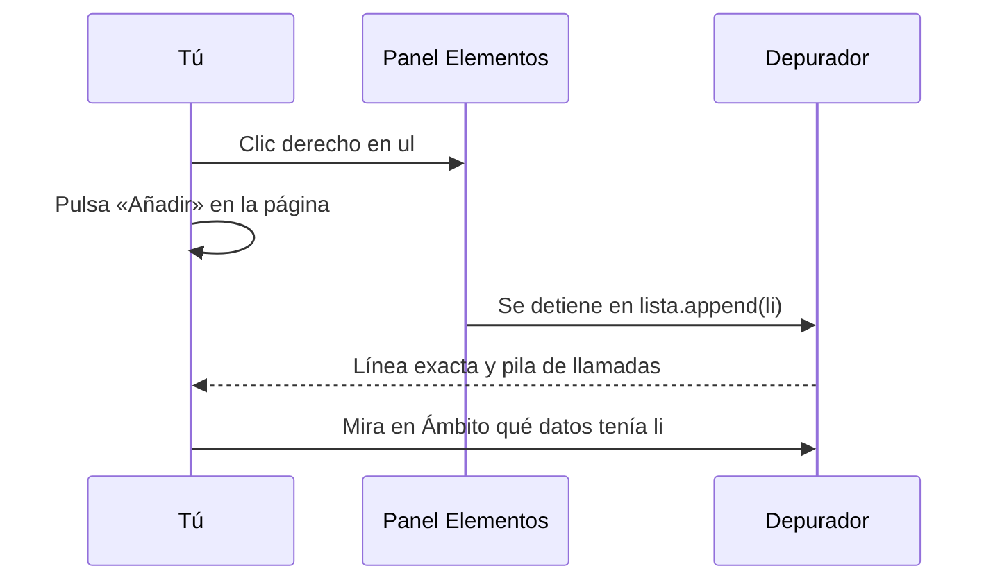

# 8. Depuración y pruebas del DOM

[⬅️ Volver a la unidad](./README.md)

## Índice

- [8.1. Qué se añade en esta unidad](#81-qué-se-añade-en-esta-unidad)
- [8.2. Depurar el DOM](#82-depurar-el-dom)
  - [8.2.1. El panel Elementos](#821-el-panel-elementos)
  - [8.2.2. Puntos de ruptura de DOM](#822-puntos-de-ruptura-de-dom)
  - [8.2.3. Puntos de ruptura de eventos](#823-puntos-de-ruptura-de-eventos)
- [8.3. Documentar un componente de interfaz](#83-documentar-un-componente-de-interfaz)
- [8.4. Tests de DOM con happy-dom](#84-tests-de-dom-con-happy-dom)
  - [8.4.1. Configurar el entorno](#841-configurar-el-entorno)
  - [8.4.2. Preparar el documento](#842-preparar-el-documento)
  - [8.4.3. Simular eventos](#843-simular-eventos)
  - [8.4.4. Qué probar y qué no](#844-qué-probar-y-qué-no)
- [8.5. Ejemplo integrador: probar el acordeón](#85-ejemplo-integrador-probar-el-acordeón)
- [8.6. El acordeón en un navegador real: Playwright](#86-el-acordeón-en-un-navegador-real-playwright)
  - [8.6.1. happy-dom o Playwright](#861-happy-dom-o-playwright)
  - [8.6.2. Los dos en el mismo proyecto](#862-los-dos-en-el-mismo-proyecto)
  - [8.6.3. Las pruebas del acordeón](#863-las-pruebas-del-acordeón)
- [Resumen](#resumen)
- [Ejercicios de reflexión](#ejercicios-de-reflexión)

> **CE que trabaja este tema:** RA6 c.

---

## 8.1. Qué se añade en esta unidad

| | UD4 | UD5 (este tema) |
|---|---|---|
| **Depuración** | Panel **Aplicación** | Panel **Elementos**, **puntos de ruptura de DOM** y **de eventos** |
| **Documentación** | Módulos que usan el navegador | **Componentes de interfaz**: qué HTML necesitan, qué clases y eventos usan |
| **Pruebas** | Mocks de almacenamiento y fecha | **Tests de DOM** con happy-dom |

El CE c pide **verificar** el código que accede al documento: los tests de DOM son la forma automática de hacerlo.

---

## 8.2. Depurar el DOM

Los nombres de este apartado son los de Chrome con la interfaz en español, con el original en inglés entre paréntesis. Pueden cambiar de una versión a otra, y las DevTools a veces se abren en inglés aunque Chrome esté en español (UD2, tema 2).

### 8.2.1. El panel Elementos

| Herramienta | Para qué |
|-------------|----------|
| Seleccionar un elemento y usar `$0` en la consola | Probar selectores y propiedades sobre él |
| `$('selector')` y `$$('selector')` en la consola | Atajos de `querySelector` y `querySelectorAll` (este último devuelve un array) |
| Pestaña **Procesadores de eventos** (*Event Listeners*) del panel lateral | Ver qué oyentes tiene un elemento y en qué línea están |
| Pestaña **Propiedades** (*Properties*) | Ver el objeto con su cadena de herencia (tema 2) |
| Resaltado al modificarse | Los nodos que cambia tu código parpadean en morado |
| **Forzar estado** (*Force state*): `:hover`, `:focus`… | Probar estilos de estados |

Las DevTools en español llaman **procesadores de eventos** a lo que en este curso llamamos **oyentes**.

### 8.2.2. Puntos de ruptura de DOM

Cuando "algo" cambia un elemento y no sabes qué código es, clic derecho sobre el elemento en el panel Elementos → **Interrupción en** (*Break on*):

| Opción | Se detiene cuando… |
|--------|---------------------|
| **Subárbol modificado** (*Subtree modifications*) | Se añade, quita o cambia un hijo o descendiente |
| **Atributo modificado** (*Attribute modifications*) | Cambia un atributo del elemento (incluidas las clases) |
| **Nodo retirado** (*Node removal*) | Se elimina el elemento |

La ejecución se detiene en la línea que hace el cambio, con la **pila de llamadas** (UD3) para ver quién la llamó.



El diagrama muestra el flujo: se marca el elemento, se reproduce la acción y el depurador se detiene justo en el código que lo modifica.

### 8.2.3. Puntos de ruptura de eventos

En el panel **Fuentes** (*Sources*), sección **Puntos de interrupción del procesador de eventos** (*Event Listener Breakpoints*), marca un evento de una categoría (por ejemplo, **Ratón → click**): la ejecución se detendrá en el primer oyente que se ejecute para cualquier clic. Es la forma de encontrar qué código responde a un evento en una página que no conoces.

> 💡 **Tip del Examinador**: "Un elemento desaparece de la página y no sabes qué código lo quita. ¿Qué haces?" → En el panel Elementos, clic derecho sobre su padre → **Interrupción en** → **Subárbol modificado** (o sobre el elemento → **Nodo retirado**). La ejecución se detendrá en la línea que lo elimina.

---

## 8.3. Documentar un componente de interfaz

Un **componente de interfaz** es un trozo de página con su estructura, su aspecto y su comportamiento (un acordeón, unas pestañas, una tarjeta). Además del JSDoc de sus funciones, su documentación debe decir:

| Qué | Por qué |
|-----|---------|
| El **HTML** que necesita (estructura, clases, atributos) | Si falta, el código no encuentra los elementos |
| Las **clases y atributos de estado** que cambia | El CSS tiene que tener reglas para ellos |
| Los **eventos** que escucha (y los que emite, si los hay) | Para integrarlo con el resto |
| Qué pasa **sin JavaScript** o en navegadores antiguos | Mejora progresiva y compatibilidad |

```js
/**
 * Acordeón de preguntas frecuentes.
 *
 * HTML necesario: un contenedor con elementos `.faq-item`, cada uno con un botón `.faq-pregunta`
 * y un `.faq-respuesta`. Sin JavaScript, todas las respuestas se ven.
 *
 * Estado: cambia `aria-expanded` en el botón y `hidden` en la respuesta. El CSS debe ocultar
 * `[hidden]` y puede usar `[aria-expanded]` para la flecha.
 *
 * Eventos: un único oyente `click` en el contenedor (delegación).
 *
 * @module acordeon
 * @example
 * iniciarAcordeon(document.querySelector('#faq'));
 */
```

---

## 8.4. Tests de DOM con happy-dom

En Node.js no hay DOM (tema 1). **happy-dom** (y su alternativa **jsdom**) son implementaciones del DOM escritas en JavaScript: crean `document`, `window`, los elementos y los eventos en memoria, sin navegador. Vitest puede ejecutar los tests en ese entorno.

| | happy-dom | jsdom | Playwright (tema 6) |
|---|---|---|---|
| Qué es | DOM simulado, rápido | DOM simulado, más completo | Navegadores reales |
| Velocidad | Muy rápida | Rápida | Lenta |
| Pinta la página (CSS, tamaños) | ❌ | ❌ | ✅ |
| Uso | Tests de integración: tu código junto con el DOM | Igual | Pruebas de extremo a extremo en varios motores |

> 📝 **Nota del Profesor**: Recuerda la pirámide de pruebas de la UD1 (tema 6). Un test **unitario** prueba una función aislada; uno **de integración** prueba varias piezas juntas; uno **de extremo a extremo**, la aplicación completa en un navegador real. Los tests de DOM de este tema son **de integración**: comprueban a la vez tu código y el documento (que un clic añade una fila a la tabla, que un campo vacío muestra un error). Si una función no toca el DOM (calcular un total, formatear una fecha), pruébala con un test unitario normal, sin happy-dom: es más rápido y, si falla, sabes exactamente qué función está mal.

### 8.4.1. Configurar el entorno

```bash
npm install -D vitest happy-dom
```

```js
// vitest.config.js
import { defineConfig } from 'vitest/config';

export default defineConfig({
  test: { environment: 'happy-dom' }, // todos los tests tienen document y window
});
```

También se puede activar solo en un fichero, con un comentario en su primera línea: `// @vitest-environment happy-dom`.

### 8.4.2. Preparar el documento

Cada test prepara el **HTML** que necesita y llama a la función que se prueba. Para que los tests sean independientes, el documento se rehace en `beforeEach`:

```js
// tests/indice.test.js
import { describe, it, expect, beforeEach } from 'vitest';
import { leerApartados } from '../js/indice.js';

describe('leerApartados', () => {
  beforeEach(() => {
    document.body.innerHTML = `
      <article id="articulo">
        <h2 id="intro">Introducción</h2>
        <h2>Instalación</h2><h3>Windows</h3><h3>Linux</h3>
      </article>`;
  });

  it('lee el id, el texto y los subapartados de cada h2', () => {
    expect(leerApartados(document.querySelector('#articulo'))).toEqual([
      { id: 'intro', texto: 'Introducción', subapartados: 0 },
      { id: 'apartado-2', texto: 'Instalación', subapartados: 2 },
    ]);
  });

  it('devuelve una lista vacía si no hay apartados', () => {
    document.body.innerHTML = '<article id="articulo"><p>Sin títulos</p></article>';
    expect(leerApartados(document.querySelector('#articulo'))).toEqual([]);
  });
});
```

> ✅ **Buena práctica**: Escribe las funciones del DOM para que **reciban** el elemento raíz (como `leerApartados(articulo)` o `iniciarAcordeon(contenedor)`) en lugar de buscarlo con `document.querySelector` dentro. Así el test le pasa el HTML que quiera, igual que con la inyección de dependencias de la UD4.

### 8.4.3. Simular eventos

Para probar el comportamiento, se **disparan** eventos como si los hiciera el usuario:

```js
boton.click();                                    // un clic

campo.value = 'hola';
campo.dispatchEvent(new Event('input', { bubbles: true })); // el usuario ha escrito

casilla.checked = true;
casilla.dispatchEvent(new Event('change', { bubbles: true })); // el usuario ha marcado la casilla

campo.dispatchEvent(new KeyboardEvent('keydown', { key: 'Enter', bubbles: true }));
```

> ⚠️ **Cuidado**: Cambiar `campo.value` desde el código **no** lanza el evento `input`. En los tests hay que dispararlo a mano después. Y pon `bubbles: true` si el oyente está en un contenedor (delegación): si no, el evento no sube.

### 8.4.4. Qué probar y qué no

| ✅ Se prueba con happy-dom | ❌ No se prueba (o se prueba con Playwright) |
|----------------------------|---------------------------------------------|
| Que se crean los elementos con el texto y los atributos correctos | Que se **ven** bien (colores, posiciones, tamaños) |
| Que las clases y atributos de estado cambian al hacer algo | Animaciones y transiciones |
| Que los datos del usuario se insertan como texto (seguridad) | El comportamiento en cada navegador real |
| Que los eventos llaman a lo que deben | El rendimiento |

---

## 8.5. Ejemplo integrador: probar el acordeón

El acordeón del tema 7, escrito como una función que recibe su contenedor, y sus tests.

```js
// js/acordeon.js
/**
 * Inicia un acordeón: cierra todas las respuestas y abre o cierra cada una al pulsar su pregunta.
 * @param {HTMLElement} contenedor Elemento con los `.faq-item`.
 */
export function iniciarAcordeon(contenedor) {
  const alternar = (boton, abrir) => {
    boton.setAttribute('aria-expanded', String(abrir));
    boton.closest('.faq-item').querySelector('.faq-respuesta').hidden = !abrir;
  };
  contenedor.querySelectorAll('.faq-pregunta').forEach((boton) => alternar(boton, false));
  contenedor.addEventListener('click', (evento) => {
    const boton = evento.target.closest('.faq-pregunta');
    if (boton) alternar(boton, boton.getAttribute('aria-expanded') !== 'true');
  });
}
```

```js
// tests/acordeon.test.js
import { describe, it, expect, beforeEach } from 'vitest';
import { iniciarAcordeon } from '../js/acordeon.js';

describe('iniciarAcordeon', () => {
  let contenedor;

  beforeEach(() => {
    document.body.innerHTML = `
      <section id="faq">
        <div class="faq-item">
          <h3><button class="faq-pregunta" aria-expanded="true">¿Envío?</button></h3>
          <div class="faq-respuesta"><p>24 horas</p></div>
        </div>
        <div class="faq-item">
          <h3><button class="faq-pregunta" aria-expanded="true">¿Devolución?</button></h3>
          <div class="faq-respuesta"><p>30 días</p></div>
        </div>
      </section>`;
    contenedor = document.querySelector('#faq');
    iniciarAcordeon(contenedor);
  });

  const preguntas = () => [...contenedor.querySelectorAll('.faq-pregunta')];
  const respuestas = () => [...contenedor.querySelectorAll('.faq-respuesta')];

  it('al iniciar cierra todas las respuestas', () => {
    expect(respuestas().map((r) => r.hidden)).toEqual([true, true]);
    expect(preguntas().map((p) => p.getAttribute('aria-expanded'))).toEqual(['false', 'false']);
  });

  it('al pulsar una pregunta abre solo su respuesta', () => {
    preguntas()[1].click();
    expect(respuestas().map((r) => r.hidden)).toEqual([true, false]);
    expect(preguntas()[1].getAttribute('aria-expanded')).toBe('true');
  });

  it('al pulsarla otra vez la cierra', () => {
    preguntas()[0].click();
    preguntas()[0].click();
    expect(respuestas()[0].hidden).toBe(true);
  });

  it('un clic fuera de las preguntas no cambia nada', () => {
    contenedor.querySelector('p').click();
    expect(respuestas().map((r) => r.hidden)).toEqual([true, true]);
  });
});
```

```text
// Salida de npm test:
 ✓ tests/acordeon.test.js (4 tests)

 Test Files  1 passed (1)
      Tests  4 passed (4)
```

| Técnica | Dónde |
|---------|-------|
| Documentar el componente | Qué HTML necesita, qué estado cambia, qué eventos usa |
| Entorno happy-dom | `vitest.config.js` |
| HTML de prueba nuevo en cada test | `beforeEach` con `document.body.innerHTML` |
| La función recibe su contenedor | `iniciarAcordeon(contenedor)` |
| Simular al usuario | `click()` |
| Comprobar el estado, no el aspecto | `hidden` y `aria-expanded` |

---

## 8.6. El acordeón en un navegador real: Playwright

En el tema 6 usaste **Playwright** para comprobar la misma página en tres motores. También sirve para lo que happy-dom no puede ver: la página entera, con su CSS, en un navegador de verdad, usada como la usaría una persona. Son las pruebas **de extremo a extremo** (*end-to-end*), la punta de la pirámide de la UD1 (tema 6): pocas, más lentas y muy realistas. Desde el E09 de esta unidad, los ejercicios llevan las dos clases de pruebas.

### 8.6.1. happy-dom o Playwright

| | Tests de DOM (happy-dom) | Pruebas de extremo a extremo (Playwright) |
|---|---|---|
| Tipo en la pirámide | De integración: tu código con un DOM simulado | De extremo a extremo: la página entera |
| Dónde se ejecutan | En Node.js, en milisegundos | En un navegador real, en segundos |
| Qué comprueban bien | Estructura, texto, clases y atributos de estado, que cada evento llama a lo que debe | Lo que se **ve** (con el CSS aplicado), el foco y el teclado reales, la página sin JavaScript, un recorrido completo |
| Cuántas | Muchas: una por comportamiento y caso límite | Pocas: los recorridos principales |
| Carpeta y orden | `tests/`, `npm test` | `e2e/`, `npm run e2e` |

Si algo se puede comprobar con happy-dom, compruébalo ahí: es más rápido y, si falla, el error está más localizado. Deja para Playwright lo que solo existe en un navegador real.

### 8.6.2. Los dos en el mismo proyecto

```text
acordeon/
├── package.json          ← "test": "vitest run" y "e2e": "playwright test"
├── vitest.config.js      ← happy-dom, sin la carpeta e2e/
├── playwright.config.js  ← carpeta e2e/, servidor de la página y Chromium
├── index.html · js/acordeon.js · js/main.js
├── tests/
│   └── acordeon.test.js  ← tests de DOM (8.5)
└── e2e/
    └── acordeon.spec.js  ← pruebas de extremo a extremo
```

Vitest busca por defecto todos los ficheros `.test.js` **y** `.spec.js`, así que hay que decirle que no lea `e2e/`:

```js
// vitest.config.js
import { configDefaults, defineConfig } from 'vitest/config';

export default defineConfig({
  test: {
    environment: 'happy-dom',
    exclude: [...configDefaults.exclude, 'e2e/**'], // las pruebas de e2e/ son de Playwright
  },
});
```

```js
// playwright.config.js
import { defineConfig, devices } from '@playwright/test';

export default defineConfig({
  testDir: 'e2e',
  use: { baseURL: 'http://localhost:3000' },
  // Arranca el servidor de la página antes de las pruebas (o usa el que ya esté en marcha)
  webServer: {
    command: 'npx --yes serve@14.2.6 --no-clipboard --listen 3000 .',
    url: 'http://localhost:3000',
    reuseExistingServer: true,
  },
  projects: [{ name: 'chromium', use: { ...devices['Desktop Chrome'] } }],
});
```

- `baseURL` permite escribir `page.goto('/')` en lugar de la dirección completa.
- `reuseExistingServer: true` aprovecha el servidor que ya tengas arrancado (el del Dev Container); si no hay ninguno, Playwright lo arranca y lo para al terminar.
- Basta con un motor, **Chromium**: la compatibilidad entre motores ya la comprobaste en el tema 6. Por la misma razón, en los Dev Container de los ejercicios el `Dockerfile` instala solo ese navegador.
- La versión de `@playwright/test` va fija en `package.json` (sin `^`): cada versión de Playwright necesita su versión exacta de los navegadores.

### 8.6.3. Las pruebas del acordeón

```js
// e2e/acordeon.spec.js
import { test, expect } from '@playwright/test';

test.beforeEach(async ({ page }) => {
  await page.goto('/');
});

test('al cargar, las respuestas están ocultas', async ({ page }) => {
  await expect(page.getByText('24 horas')).toBeHidden();
  await expect(page.getByText('30 días')).toBeHidden();
});

test('una pregunta muestra su respuesta y, pulsada otra vez, la oculta', async ({ page }) => {
  const pregunta = page.getByRole('button', { name: '¿Envío?' });
  await pregunta.click();
  await expect(page.getByText('24 horas')).toBeVisible();
  await expect(pregunta).toHaveAttribute('aria-expanded', 'true');
  await expect(page.getByText('30 días')).toBeHidden();
  await pregunta.click();
  await expect(page.getByText('24 horas')).toBeHidden();
});

test('se usa con el teclado', async ({ page }) => {
  await page.keyboard.press('Tab'); // el foco pasa a la primera pregunta
  await expect(page.getByRole('button', { name: '¿Envío?' })).toBeFocused();
  await page.keyboard.press('Enter');
  await expect(page.getByText('24 horas')).toBeVisible();
});

test.describe('sin JavaScript', () => {
  test.use({ javaScriptEnabled: false });

  test('se ven todas las respuestas', async ({ page }) => {
    await expect(page.getByText('24 horas')).toBeVisible();
    await expect(page.getByText('30 días')).toBeVisible();
  });
});
```

```text
// Salida de npm run e2e:
Running 4 tests using 1 worker

  ✓  1 [chromium] › e2e/acordeon.spec.js:7:1 › al cargar, las respuestas están ocultas (92ms)
  ✓  2 [chromium] › e2e/acordeon.spec.js:12:1 › una pregunta muestra su respuesta y, pulsada otra vez, la oculta (226ms)
  ✓  3 [chromium] › e2e/acordeon.spec.js:22:1 › se usa con el teclado (65ms)
  ✓  4 [chromium] › e2e/acordeon.spec.js:32:3 › sin JavaScript › se ven todas las respuestas (52ms)

  4 passed (2.9s)
```

Fíjate en lo que comprueban estas pruebas y no los tests de DOM:

- `toBeVisible` y `toBeHidden` miran lo que **se ve**, con el CSS aplicado, no solo el atributo `hidden`.
- El teclado es el de verdad: `Tab` mueve el foco como lo haría el navegador, y `Enter` sobre un `<button>` lo pulsa sin que el código escuche ninguna tecla.
- `test.use({ javaScriptEnabled: false })` abre la página **sin JavaScript**: es la forma de comprobar la mejora progresiva del tema 6.

> 📝 **Nota del Profesor**: Como en el tema 6, `async` y `await` aparecen porque cada acción espera a que el navegador termine; úsalos como en los ejemplos hasta que los estudies en la UD7. Busca los elementos como los encuentra una persona (`getByRole`, `getByLabel`, `getByText`), no por sus clases: si mañana cambia el CSS, las pruebas siguen valiendo.

> 💡 **Tip del Examinador**: "¿Qué pruebas con happy-dom y qué con Playwright?" → Con happy-dom, la estructura y el estado que crea tu código (rápido y localizado); con Playwright, lo que solo existe en un navegador real: lo que se ve con el CSS, el foco y el teclado, la página sin JavaScript y los recorridos completos.

---

## Resumen

- En el panel **Elementos**, `$0`, la pestaña **Procesadores de eventos** y los **puntos de ruptura de DOM** (cambios en el subárbol, en los atributos o al eliminar un nodo) localizan qué código cambia la página.
- Los **puntos de ruptura de eventos** detienen la ejecución en el primer oyente de un tipo de evento.
- Documenta los componentes: HTML necesario, clases y atributos de estado, eventos y qué pasa sin JavaScript.
- **happy-dom** (o jsdom) crea un DOM en Node.js para que Vitest pruebe el código del DOM: `environment: 'happy-dom'`.
- Cada test prepara su HTML en `beforeEach`; las funciones reciben su contenedor; los eventos se simulan con `click()` y `dispatchEvent` (con `bubbles: true` si hay delegación).
- Se prueban la estructura, el texto y el estado (clases, atributos), no el aspecto visual.
- Lo que solo existe en un navegador real (lo que se ve con el CSS, el foco y el teclado, la página sin JavaScript) se prueba con **Playwright**, en `e2e/` y con `npm run e2e`: pocas pruebas de extremo a extremo, con Chromium y el `webServer` de su configuración. Vitest no debe leer `e2e/`.

## Ejercicios de reflexión

1. Pon un punto de ruptura **Subárbol modificado** en una lista de tus ejercicios y añade un elemento. ¿Qué te muestra la pila de llamadas?
2. ¿Por qué `campo.value = 'x'` en un test no ejecuta el oyente de `input`? ¿Cómo lo resuelves?
3. ¿Qué cambiarías en una función que hace `document.querySelector('#lista')` dentro para poder probarla con distintos HTML?
4. ¿Qué no puede comprobar happy-dom que sí puede comprobar Playwright? Pon un ejemplo.
5. Escribe (sin ejecutarlo) un test que compruebe que un nombre con `<b>` se muestra como texto en una lista creada por tu código.

---

[⬅️ Volver a la unidad](./README.md)
