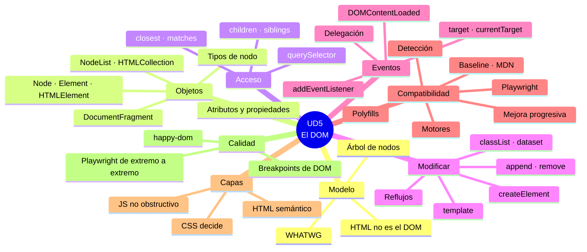

# 9. Resumen y mapa mental

[⬅️ Volver a la unidad](./README.md)

- [9. Resumen y mapa mental](#9-resumen-y-mapa-mental)
  - [Resumen ejecutivo](#resumen-ejecutivo)
  - [Mapa mental](#mapa-mental)
  - [Checklist de evaluación](#checklist-de-evaluación)
    - [El modelo de objetos (CE a, b)](#el-modelo-de-objetos-ce-a-b)
    - [Acceder al documento (CE c)](#acceder-al-documento-ce-c)
    - [Crear y modificar elementos (CE d)](#crear-y-modificar-elementos-ce-d)
    - [Eventos (CE e)](#eventos-ce-e)
    - [Compatibilidad entre navegadores (CE f, g)](#compatibilidad-entre-navegadores-ce-f-g)
    - [Separación de capas (CE h)](#separación-de-capas-ce-h)
    - [Depuración y pruebas (CE c)](#depuración-y-pruebas-ce-c)

## Resumen ejecutivo

En esta unidad has aprendido a **trabajar con la página como un árbol de objetos**, de forma que funcione en todos los navegadores y con las capas separadas:

1. **Qué es el DOM**: el árbol de nodos que construye el navegador a partir del HTML, su relación con el BOM y el estándar vivo del WHATWG.
2. **Los objetos del modelo**: la jerarquía `EventTarget` → `Node` → `Element` → `HTMLElement`, los tipos de nodo, atributos frente a propiedades, `NodeList` estática y viva, `HTMLCollection` y `DocumentFragment`.
3. **Acceder al documento**: `getElementById`, `querySelector(All)`, `matches`, `closest`, recorrer por elementos y nodos, y verificar los accesos.
4. **Modificar el documento**: `createElement`, `<template>`, insertar, mover, reemplazar y eliminar, atributos, `dataset`, `classList`, estilos y rendimiento.
5. **Eventos del modelo**: `addEventListener`, el objeto evento, las formas antiguas, `DOMContentLoaded` y `load`, y la delegación.
6. **Compatibilidad entre navegadores**: motores, el modelo de Internet Explorer, Baseline, MDN y caniuse, detección de características, mejora progresiva, polyfills, transpilación y Playwright.
7. **Separación de capas**: HTML semántico, el CSS decide el aspecto, JavaScript no obstructivo y cómo se comunican las capas.
8. **Depuración y pruebas**: el panel Elementos, puntos de ruptura de DOM y de eventos, documentar componentes, tests de DOM con happy-dom y pruebas de extremo a extremo con Playwright.

## Mapa mental

## Checklist de evaluación

### El modelo de objetos (CE a, b)

- [ ] Explico qué es el DOM y en qué se diferencia del HTML que llega del servidor
- [ ] Dibujo el árbol de nodos de un fragmento de HTML, con sus nodos de texto
- [ ] Sitúo el DOM respecto al BOM y a JavaScript, y sé quién define el estándar
- [ ] Conozco la jerarquía `EventTarget` → `Node` → `Element` → `HTMLElement` y lo que aporta cada interfaz
- [ ] Distingo los tipos de nodo y uso `nodeType` con sus constantes
- [ ] Diferencio un atributo de una propiedad
- [ ] Distingo una `NodeList` estática, una viva y una `HTMLCollection`, y las convierto en arrays

### Acceder al documento (CE c)

- [ ] Sé cuándo el DOM está listo para buscar elementos
- [ ] Busco elementos con `getElementById` y con selectores CSS en `querySelector(All)`, también dentro de un elemento
- [ ] Uso `matches` y `closest`
- [ ] Recorro el árbol por elementos y por nodos
- [ ] Leo texto, atributos, `dataset`, valores y clases
- [ ] Verifico mis accesos: trato el `null` y pruebo los selectores en la consola

### Crear y modificar elementos (CE d)

- [ ] Creo elementos con `createElement` y los relleno con `textContent`
- [ ] Uso `<template>` y `cloneNode(true)` para estructuras repetidas
- [ ] Inserto, muevo, reemplazo y elimino nodos
- [ ] Cambio atributos, `dataset` y clases con `classList`
- [ ] Preparo muchos nodos fuera de la página y los inserto de una vez

### Eventos (CE e)

- [ ] Asocio acciones con `addEventListener` y uso el objeto evento
- [ ] Sé por qué no se usan `onclick` en el HTML ni la propiedad `onclick`
- [ ] Distingo `DOMContentLoaded` y `load`
- [ ] Uso la delegación de eventos para los elementos creados después

### Compatibilidad entre navegadores (CE f, g)

- [ ] Conozco los motores de los navegadores y el origen histórico de las diferencias
- [ ] Consulto Baseline, MDN y caniuse antes de usar una API
- [ ] Detecto características y ofrezco una alternativa
- [ ] Aplico la mejora progresiva
- [ ] Sé qué son un polyfill y la transpilación
- [ ] Pruebo una página en Chromium, Firefox y WebKit con Playwright

### Separación de capas (CE h)

- [ ] Escribo HTML semántico, con clases que dicen qué es cada cosa
- [ ] Cambio el aspecto con clases y atributos, no con estilos desde el JavaScript
- [ ] Escribo JavaScript no obstructivo
- [ ] Organizo el proyecto en carpetas por capa y separo la lógica de la vista
- [ ] Refactorizo una página que mezcla las capas

### Depuración y pruebas (CE c)

- [ ] Uso el panel Elementos, `$0` y la pestaña Procesadores de eventos
- [ ] Encuentro qué código cambia la página con los puntos de ruptura de DOM y de eventos
- [ ] Documento un componente: el HTML que necesita, el estado que cambia y los eventos que usa
- [ ] Escribo tests de DOM con happy-dom que preparan su HTML y simulan eventos
- [ ] Escribo pruebas de extremo a extremo con Playwright para lo que solo existe en un navegador real
- [ ] Sé qué comprobar con happy-dom y qué con Playwright

---

[⬅️ Volver a la unidad](./README.md)
