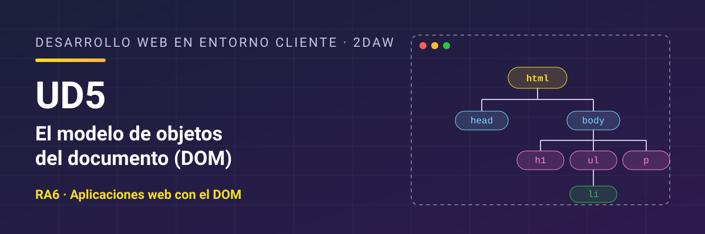

# Desarrollo Web en Entorno Cliente - UD5 El modelo de objetos del documento (DOM)

Unidad 5 El modelo de objetos del documento (DOM). 2DAW.

## Resultado de aprendizaje

Esta unidad trabaja el **RA6** y sus criterios de evaluación: [ver resultado de aprendizaje y criterios de evaluación](./resultados-aprendizaje.md).

## Referencias

- [*Eloquent JavaScript*](https://www.eloquentjavascript.es/), de Marijn Haverbeke (4.ª edición, traducida al español por midudev; licencia CC BY-NC). Libro gratuito en línea que explica el lenguaje y el navegador con otro enfoque y trae ejercicios. Es una buena lectura complementaria para cualquier unidad del curso. Ten en cuenta que llama **enlace** (*binding*) a lo que en el curso llamamos **variable** o **constante**, que usa comillas dobles y, a veces, `prompt`, y que la traducción tiene alguna errata. Si algo no cuadra, consulta el original en inglés en [eloquentjavascript.net](https://eloquentjavascript.net/).

## Contenidos

1. [Qué es el DOM](./01-que-es-el-dom.md)
2. [Los objetos del modelo](./02-objetos-del-modelo.md)
3. [Acceder al documento](./03-acceso-documento.md)
4. [Modificar el documento](./04-modificar-documento.md)
5. [Eventos del modelo](./05-eventos-del-modelo.md)
6. [Compatibilidad entre navegadores](./06-compatibilidad-navegadores.md)
7. [Separación de capas](./07-separacion-capas.md)
8. [Depuración y pruebas del DOM](./08-depuracion-pruebas.md)
9. [Resumen](./09-resumen.md)

## Licencia

Este material se distribuye bajo licencia **Creative Commons BY-NC-SA 4.0**. Consulta las condiciones en [LICENSE.md](./LICENSE.md).
